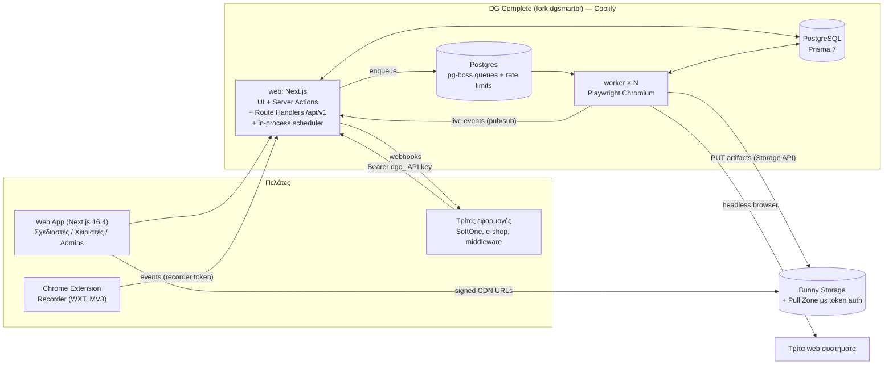
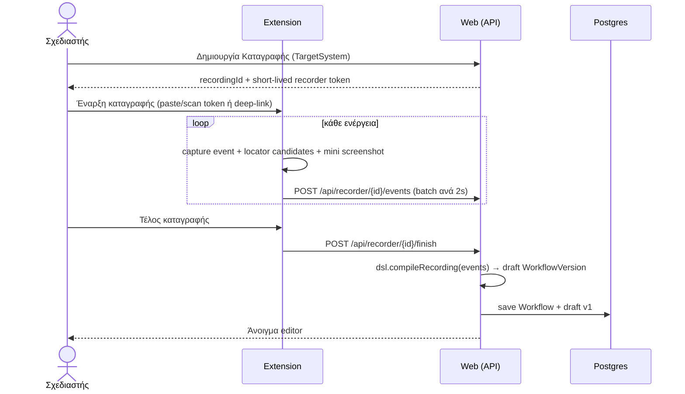
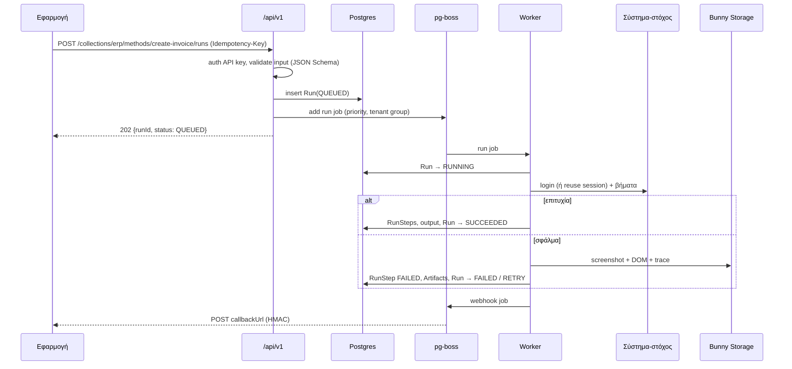
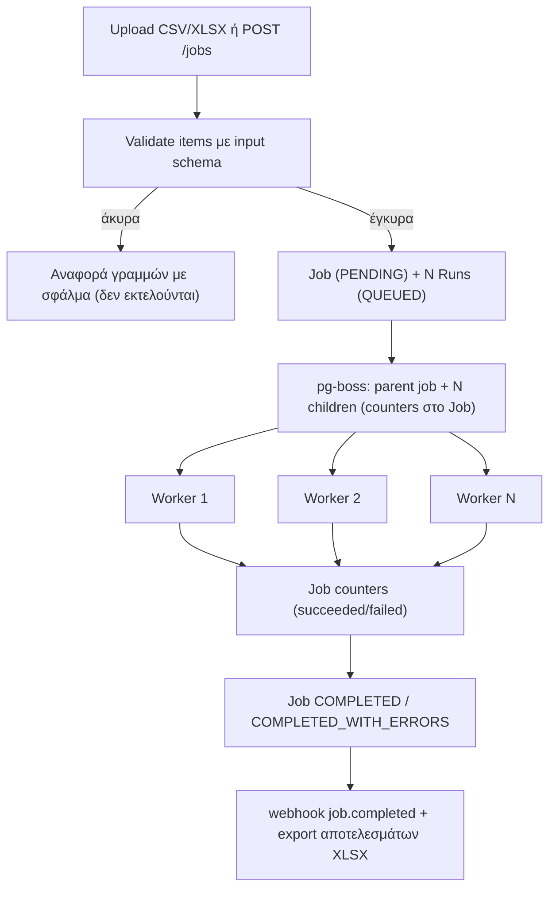
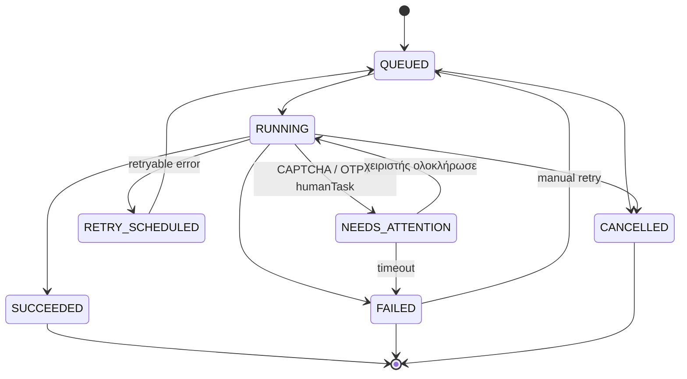

# 01 — Αρχιτεκτονική

## 1. Λογική αρχιτεκτονική



### Γιατί ξεχωριστός worker
Ο Playwright browser **δεν τρέχει μέσα στο Next.js**. Το web μένει ελαφρύ (UI + API + enqueue) και κλιμακώνεται ξεχωριστά από τους workers, που έχουν δικό τους Docker target με Chromium. Όλα τα συστήματα‑στόχοι είναι web και προσβάσιμα από το internet — **δεν** υπάρχει on‑prem agent.

## 2. Δομή repo (fork του dgsmartbi — όχι monorepo)

Ένα repo, ένα `package.json` (npm, όπως το dgsmartbi), δύο runtime entrypoints (web, worker) και δύο βοηθητικά projects (extension, sandbox). Λεπτομέρειες για το τι κρατάμε από το dgsmartbi: [15-fork-dgsmartbi.md](15-fork-dgsmartbi.md).

```
dg-complete/
├─ app/
│  ├─ admin/                 # πλατφόρμα DGSoft (tenants, πακέτα, πληρωμές, ρυθμίσεις) — από dgsmartbi
│  ├─ t/[tenantId]/          # περιοχή tenant — νέο IA (docs/09)
│  ├─ api/auth/[...all]      # Better Auth
│  ├─ api/v1/                # public API (docs/07)
│  ├─ api/recorder/          # endpoints του extension
│  ├─ api/stream/            # SSE live πρόοδος
│  ├─ api/artifacts/[id]     # έλεγχος δικαιώματος → 302 σε signed Bunny URL
│  └─ api/internal/cron/     # in-process scheduler (από dgsmartbi)
├─ lib/
│  ├─ auth.ts rbac.ts prisma.ts crypto.ts audit.ts email.ts softone*.ts scheduler.ts   # από dgsmartbi
│  ├─ services.ts tenant-services.ts api-keys.ts                                       # προσαρμοσμένα
│  ├─ dsl/        # Workflow DSL (καθαρό TS· το χρησιμοποιούν web, worker, extension)
│  ├─ engine/     # Playwright step executors, locator resolver, error taxonomy, redaction
│  ├─ queue/      # pg-boss queues, payload schemas, producers
│  ├─ storage/    # Bunny Storage + signed URLs (+ local driver για dev/tests)
│  ├─ billing/    # ledger εκτελέσεων, quotas (docs/14)
│  └─ recorder/   # recorder tokens, compile καταγραφής
├─ worker/        # pg-boss consumers + browser pool (τρέχει με --conditions=react-server)
├─ extension/     # WXT + React (δικό του package.json, εισάγει ../lib/dsl)
├─ sandbox/       # δοκιμαστικό «τρίτο σύστημα» (port 4100)
├─ prisma/        # schema.prisma + migrations, prisma.config.ts
├─ docs/  prompts/  design/
└─ Dockerfile     # targets: web, worker
```

## 3. Τεχνολογίες & εκδόσεις

| Περιοχή | Επιλογή | Σημειώσεις |
|---|---|---|
| Runtime | Node.js 24 LTS | Το dgsmartbi έχει `node:22` στο Dockerfile — αναβάθμιση στο P00 |
| Web | **Next.js 16.4+**, React 19.3 | upgrade από 16.3.8· `cacheComponents: true`, `proxy.ts` |
| ORM | **Prisma ORM 7** (`prisma-client` generator, `@prisma/adapter-pg`) + PostgreSQL | όπως το dgsmartbi· pin `^7` (το `npm i prisma` χωρίς έκδοση φέρνει πλέον το 8) |
| Auth | **Better Auth** (email/κωδικός, προσκλήσεις, reset) + Microsoft Entra ID | από το dgsmartbi |
| UI | shadcn/ui (`radix-nova`) + **Vengeance UI** + Tailwind v4, lucide icons | DG θέμα ήδη στο `app/globals.css` |
| Motion | GSAP 3 (`@gsap/react`) | διακριτικές μεταβάσεις (DG motion tokens) |
| Forms / validation | `<form action>` + Server Actions + zod 4 (χωρίς react-hook-form, ADR‑023) | ίδια schemas σε server/DSL· σφάλματα πεδίων από το action |
| Πίνακες | TanStack Table v8 (+ virtual) | το dgsmartbi έχει ήδη `components/data-table` |
| Οπτικός καμβάς ροών | @xyflow/react v12 + elkjs + zustand | επεξεργασία ροής, live εκτέλεση, heatmap, diff (docs/19) |
| Code/JSON | Monaco editor | input schema, DSL raw view |
| Ουρές | **pg-boss** (Postgres) | runs, jobs, webhooks, imports — χωρίς Redis/Valkey (ADR‑022) |
| Browser | **Playwright** (Chromium) | trace, screenshots με `mask` |
| Αρχεία | **Bunny Storage** (Storage API) + **Pull Zone με Token Authentication** (signed URLs) | ιδιωτικά· ποτέ δημόσιο URL |
| Email | Mailgun | από το dgsmartbi |
| Εξαγωγές | exceljs | από το dgsmartbi |
| Extension | WXT + React + Tailwind | Chrome/Edge MV3 |
| API docs | OpenAPI 3.1 (από zod/JSON Schema) + Scalar | |
| Tests | Vitest, Playwright Test, Testcontainers (Postgres) | storage: local driver |
| Deploy | Docker + Coolify (Contabo) | βλ. 10 |

## 4. Κύριες ροές (sequence)

### 4.1 Καταγραφή → Workflow


### 4.2 Κλήση μεθόδου (async) από τρίτη εφαρμογή


### 4.3 Μαζική εργασία (CSV/XLSX ή API batch)


## 5. Καταστάσεις (state machines)

### Run


### WorkflowVersion
`DRAFT → PENDING_APPROVAL → PUBLISHED → DEPRECATED → ARCHIVED`. Ο Designer υποβάλλει για έγκριση· ο **TENANT_ADMIN** εγκρίνει (ή απορρίπτει με σχόλιο → πίσω σε DRAFT). Όταν ο ίδιος ο Admin είναι ο συντάκτης, η δημοσίευση γίνεται απευθείας και καταγράφεται στο audit. Μια PUBLISHED έκδοση είναι **αμετάβλητη** (checksum SHA‑256 του canonical JSON). Αλλαγή = νέα έκδοση.

## 6. Επικοινωνία real‑time
- Worker → Web: Postgres `pg_notify` στα κανάλια `run_events` / `tenant_events` (payload `{ runId, tenantId, … }`) πάνω στην απευθείας σύνδεση `QUEUE_DATABASE_URL` (ADR‑022).
- Web → Browser: **Server‑Sent Events** route handler (`/api/stream/runs/[id]`) — απλούστερο από WebSockets, δουλεύει πίσω από Coolify/Traefik.

## 7. Next.js 16.4 conventions
- `next.config.ts`: `cacheComponents: true`, `typedRoutes: true`, `reactCompiler: true`.
- Σελίδες dashboard: δυναμικά δεδομένα tenant μέσα σε `<Suspense>`· σταθερά κομμάτια (shell, navigation) prerendered.
- Χρήση `"use cache"` + `cacheTag(\`tenant:${id}:workflows\`)` για λίστες που αλλάζουν σπάνια· `revalidateTag`/`updateTag` μετά από mutations.
- **Ποτέ** caching σε `/api/v1/*` και σε οτιδήποτε περιέχει secrets/run data.
- `proxy.ts`: όπως στο dgsmartbi — optimistic έλεγχος cookie του Better Auth για `/admin`, `/t`· η πραγματική εξουσιοδότηση γίνεται σε server components/actions (`requireTenant`, `requirePermission`). Ο tenant προκύπτει από το path `/t/[tenantId]` (όχι subdomain).
- Route Handlers του `/api/v1` στο Node runtime (`export const runtime = "nodejs"`).
- Server Actions μόνο για UI mutations· πάντα `requirePermission()` πρώτα.
