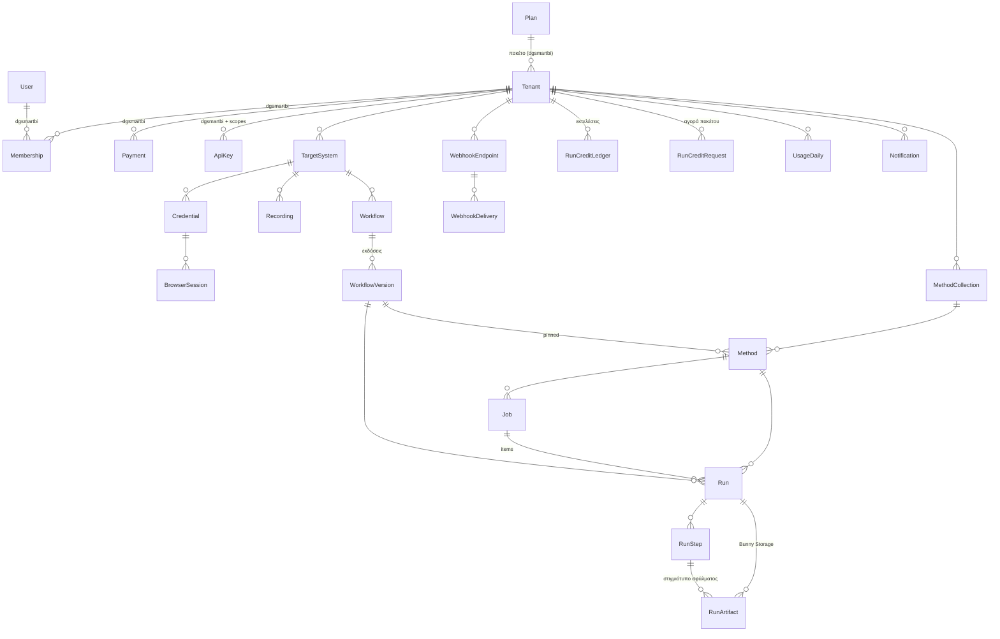

# 03 — Μοντέλο δεδομένων

Το DG Complete **επεκτείνει το schema του dgsmartbi** (Prisma 7). Οι νέοι πίνακες και οι αλλαγές σε υπάρχοντες βρίσκονται στο [`docs/schema-additions.prisma`](schema-additions.prisma) (ελέγχθηκε με `prisma@7.10.0 validate` πάνω στο schema του dgsmartbi). Τι κρατάμε/αφαιρούμε: [15-fork-dgsmartbi.md](15-fork-dgsmartbi.md).

## 1. ERD (νέες οντότητες + σημεία σύνδεσης με το dgsmartbi)



## 2. Βασικές αποφάσεις

| Θέμα | Απόφαση | Αιτιολόγηση |
|---|---|---|
| IDs | `cuid()` όπως το dgsmartbi | Συνέπεια με τη βάση |
| Ονόματα πινάκων | snake_case με `@@map` | Convention dgsmartbi |
| Tenancy | `tenantId` σε **όλους** τους νέους πίνακες (και τα child) | Απλό scoping & RLS χωρίς joins |
| Κρυπτογραφημένα πεδία | `String` στο envelope του `lib/crypto.ts` (`<keyId>.<iv>.<tag>.<ct>`) | Ίδιο keyring/rotation με dgsmartbi |
| Ορισμός ροής | `WorkflowVersion.definition` ως `jsonb` | Validation με zod στο `lib/dsl` |
| Input runs | `inputEnc` (κρυπτογραφημένο) + `inputPreview` (masked) | GDPR + δυνατότητα retry |
| Logs | `run_log` partitioned ανά μήνα | Υψηλός όγκος, φθηνή διαγραφή |
| Artifacts | Μόνο metadata στη βάση· αρχεία στο Bunny Storage (`storagePath`) | Κόστος, ταχύτητα |
| Μετρητές job | `succeededCount/failedCount` με `{ increment: 1 }` (Prisma 7 atomic) | Progress χωρίς `count(*)` |
| Χρέωση | `run_credit_ledger` με μοναδικό `key` + `Tenant.runBalance` | Ίδιο pattern με `ai_token_ledger` |

## 3. Indexes (σημαντικά)

- `run (tenantId, status, queuedAt desc)` · `run (tenantId, methodId, queuedAt desc)` · `run (tenantId, externalRef)` · unique `run (tenantId, idempotencyKey)`.
- Partial index ενεργών runs (custom SQL στο migration):
  ```sql
  CREATE INDEX run_active_idx ON "run" ("tenantId", "queuedAt")
    WHERE status IN ('QUEUED','RUNNING','RETRY_SCHEDULED','NEEDS_ATTENTION');
  ```
- GIN σε `workflow.tags`.
- `run_artifact (tenantId, expiresAt)` για τον sweeper διατήρησης.

## 4. Partitioning του `run_log`

```sql
-- custom SQL migration (το Prisma δεν διαχειρίζεται partitions): μετά το create του πίνακα
CREATE TABLE "run_log_new" (LIKE "run_log" INCLUDING ALL) PARTITION BY RANGE (ts);
-- … μεταφορά/rename, και partitions ανά μήνα:
CREATE TABLE "run_log_2026_11" PARTITION OF "run_log" FOR VALUES FROM ('2026-11-01') TO ('2026-12-01');
```
Ο scheduler (in‑process, από dgsmartbi) δημιουργεί το partition του επόμενου μήνα κάθε 25η και κάνει `DROP` τα partitions που ξεπέρασαν το μέγιστο retention· για tenants με μικρότερο retention γίνεται `DELETE` σε batches. Το `run_log` δεν έχει foreign key προς `run` (partitioned)· ο καθαρισμός γίνεται από τον sweeper.

## 5. RLS για τα ευαίσθητα μοντέλα (άμυνα σε βάθος)

```sql
DO $$
DECLARE t text;
BEGIN
  FOREACH t IN ARRAY ARRAY['credential','browser_session','recording','run','run_step','run_artifact','run_log']
  LOOP
    EXECUTE format('ALTER TABLE %I ENABLE ROW LEVEL SECURITY', t);
    EXECUTE format($p$CREATE POLICY tenant_isolation ON %I
      USING ("tenantId" = current_setting('app.tenant_id', true) OR current_setting('app.platform', true) = 'on')
      WITH CHECK ("tenantId" = current_setting('app.tenant_id', true) OR current_setting('app.platform', true) = 'on')$p$, t);
  END LOOP;
END $$;
```
- Ο ρόλος της εφαρμογής **δεν** είναι owner των πινάκων (αλλιώς η RLS παρακάμπτεται) — migrations με ρόλο migrator.
- Helper: `withTenantTx(tenantId, tx => …)` = `prisma.$transaction(async tx => { await tx.$executeRaw\`select set_config('app.tenant_id', ${tenantId}, true)\`; return fn(tx) })`.
- **PgBouncer (transaction mode):** το `set_config` είναι υποχρεωτικά transaction‑local (`true`) και γίνεται στην αρχή του ίδιου `$transaction`· κάθε query σε RLS πίνακα έξω από `withTenantTx` επιστρέφει 0 γραμμές (επιθυμητό fail‑closed).
- Οι υπόλοιποι πίνακες (dgsmartbi + workflows, methods, jobs κ.λπ.) προστατεύονται από το `tenantDb()` (docs/02 §1.1).

## 6. Αμεταβλητότητα δημοσιευμένων εκδόσεων

```sql
CREATE FUNCTION workflow_version_immutable() RETURNS trigger AS $$
BEGIN
  IF OLD.status = 'PUBLISHED' AND (NEW.definition IS DISTINCT FROM OLD.definition
     OR NEW."inputSchema" IS DISTINCT FROM OLD."inputSchema") THEN
    RAISE EXCEPTION 'published workflow version is immutable';
  END IF;
  RETURN NEW;
END $$ LANGUAGE plpgsql;
CREATE TRIGGER workflow_version_immutable BEFORE UPDATE ON "workflow_version"
  FOR EACH ROW EXECUTE FUNCTION workflow_version_immutable();
```

## 7. Seed (dev)

- Από το dgsmartbi: `npm run seed:admin` (πρώτος SUPER_ADMIN).
- Νέο `scripts/seed-dev.ts`: πακέτα Starter/Business/Enterprise (docs/14), πακέτα εκτελέσεων, tenant `Demo` (`isDemo`), χρήστες για κάθε ρόλο tenant, TargetSystem «Sandbox ERP» → `http://localhost:4100`, ροή «Καταχώριση πελάτη» v1 PUBLISHED, συλλογή `erp` + μέθοδος `create-customer`, API key (τυπώνεται στο console).
