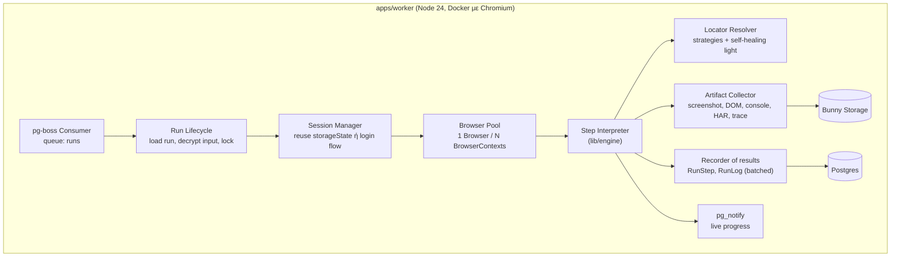
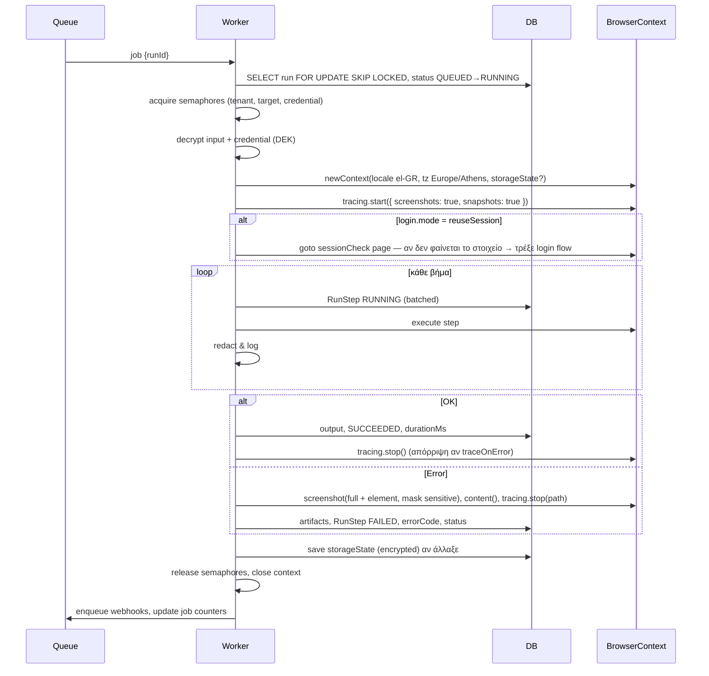

# 06 — Μηχανή εκτέλεσης (Worker)

## 1. Συστατικά



## 2. Ουρές (pg-boss, ADR‑022)

| Queue | Περιεχόμενο | Σημειώσεις |
|---|---|---|
| `runs` | `{ runId, tenantId }` | Fair scheduling ανά `tenantId`: ξεχωριστή queue ανά πλάνο + όριο ανά tenant μέσω `ConcurrencyLease` |
| `runs-priority` | sync runs & UI tests | Ξεχωριστοί consumers ώστε τα sync calls να μην περιμένουν πίσω από batch |
| `jobs` | Parent jobs (counters στο `Job`) | Ενημέρωση counters, ολοκλήρωση job |
| `webhooks` | `{ deliveryId }` | Exponential backoff: 30s, 2m, 10m, 1h, 6h, 24h → GAVE_UP |
| `imports` | `{ jobId, fileKey, mappingId? }` | Parsing CSV/XLSX και εφαρμογή προτύπου αντιστοίχισης (docs/20) |
| `files` | `{ fileId }` | Έλεγχος ιών (ClamAV), magic bytes, μετακίνηση από quarantine (docs/21) |
| `destinations` | `{ runId, destinationId }` | Αποστολή εξαγόμενων δεδομένων σε αρχείο / webhook / βάση / SoftOne, με «μόνο νέα/αλλαγμένα» (docs/26 §6) |
| `assist` | `{ runId }` | Ζωντανή προβολή για humanTask/CAPTCHA (docs/22) — CDP screencast στον worker που κρατά το session |
| `maintenance` | retention, partitions, usage rollups | Από scheduler |

**Concurrency controls**
- Ανά worker: `WORKER_CONCURRENCY` (default 8 contexts).
- Ανά tenant: `Plan.maxConcurrentRuns` — semaphore στον πίνακα `ConcurrencyLease` (ατομικό `INSERT … WHERE count < max` με TTL, ADR‑022).
- Ανά Σύστημα‑στόχο: `TargetSystem.maxConcurrency` — ίδιο μηχανισμό (scope `target`, key `{id}`). Αν δεν υπάρχει slot → νέο send με `startAfter` 2–5″ (jitter).
- Ανά credential: 1 ταυτόχρονο run αν το σύστημα δεν επιτρέπει πολλαπλά sessions (`TargetSystem.browserOptions.singleSessionPerUser`).

## 3. Κύκλος ζωής ενός run



## 4. Locator resolution & «self‑healing light»

```ts
async function resolve(page: Page, loc: Locator, ctx): Promise<{ handle: PwLocator; used: LocatorCandidate }> {
  const scope = await frameScope(page, loc.frame);
  for (const c of loc.candidates) {                 // ήδη ταξινομημένα κατά score
    const l = toPlaywright(scope, render(c, ctx));   // getByTestId / getByRole / getByLabel / locator(css) ...
    const target = loc.nth != null ? l.nth(loc.nth) : l;
    const count = await target.count();
    if (count === 1 || (loc.nth != null && count > loc.nth)) return { handle: target, used: c };
  }
  // όλοι απέτυχαν: περιμένουμε τον πρώτο έως timeout (το DOM ίσως φορτώνει)
  const first = toPlaywright(scope, render(loc.candidates[0], ctx));
  await first.waitFor({ state: "attached", timeout: ctx.timeoutMs });
  return { handle: first, used: loc.candidates[0] };
}
```
- Αν πέτυχε υποψήφιος **που δεν ήταν ο πρώτος**, γράφεται `WARN` log `LOCATOR_FALLBACK` και στατιστικό· το UI δείχνει «Το βήμα s05 χρησιμοποίησε εναλλακτικό locator σε 37% των runs — πρόταση ενημέρωσης».
- Φάση 3: **AI repair** — σε αποτυχία, στέλνουμε (μέσω του εταιρικού AI gateway / OpenRouter) το περιγραφικό του στοιχείου + απλοποιημένο DOM και παίρνουμε προτεινόμενο locator· **ποτέ** αυτόματη εφαρμογή σε PUBLISHED — μόνο πρόταση για νέο draft.

## 5. Ταξινομία σφαλμάτων (error taxonomy)

| Κωδικός | Πότε | Retryable | Ενέργεια UI |
|---|---|:-:|---|
| `E_INPUT_VALIDATION` | Input δεν ταιριάζει στο schema (πριν το queue) | ✖ | 422 στο API |
| `E_LOCATOR_NOT_FOUND` | Κανένας υποψήφιος locator | ✔ (1 φορά) | «Άλλαξε η σελίδα;» + screenshot |
| `E_ELEMENT_NOT_ACTIONABLE` | Υπάρχει αλλά disabled/καλυμμένο | ✔ | |
| `E_TIMEOUT` | Step/navigation timeout | ✔ | |
| `E_NAVIGATION` | net::ERR_*, 5xx στο document | ✔ | |
| `E_AUTH_FAILED` | Login flow απέτυχε / sessionCheck αποτυγχάνει μετά το login | ✖ | Ειδοποίηση Admin: έλεγξε διαπιστευτήριο |
| `E_OPTION_NOT_FOUND` / `E_OPTION_AMBIGUOUS` | Η τιμή λίστας δεν υπάρχει / ταιριάζει σε πολλές επιλογές (docs/25) — επιστρέφει διαθέσιμες επιλογές και πρόταση | ✖ | Σφάλμα δεδομένων, όχι incident |
| `E_OPTIONS_TIMEOUT` / `E_OPTIONS_EMPTY` / `E_DEPENDENT_RESET` | Εξαρτώμενη λίστα δεν ανανεώθηκε / ήρθε κενή / οι γονείς μηδενίζονται (docs/25) | ✔ (1 φορά) | Μετρούν για incident (docs/23) |
| `E_TARGET_VALIDATION` | Το τρίτο σύστημα εμφάνισε μήνυμα λάθους (errorDetectors) | ✖ | Το μήνυμα του συστήματος σε `targetMessage` |
| `E_ASSERTION_FAILED` | Assert step απέτυχε | ✖ | |
| `E_CAPTCHA_DETECTED` | Ανιχνεύτηκε reCAPTCHA/hCaptcha iframe | — | NEEDS_ATTENTION |
| `E_HUMAN_TIMEOUT` | humanTask δεν ολοκληρώθηκε | ✖ | |
| `E_DUPLICATE` | Το σύστημα δηλώνει ότι η εγγραφή υπάρχει (detector τύπου duplicate) | ✖ | Δυνατότητα «θεώρησε επιτυχία» ανά μέθοδο |
| `E_QUOTA_EXCEEDED` | Υπέρβαση πλάνου | ✖ | 429 στο API |
| `E_CANCELLED` | Ακύρωση από χρήστη | ✖ | |
| `E_INTERNAL` | Bug/crash browser | ✔ | Alert στο platform |

Retry policy: `Method.maxAttempts`, exponential backoff `retryBackoffSec * 2^(attempt-1)` + jitter. **Προσοχή στις διπλοεγγραφές:** για βήματα μετά το «Αποθήκευση» (`commitPoint: true` σε step), ένα retry επιτρέπεται **μόνο** αν η ροή έχει `idempotencyCheck` (π.χ. αναζήτηση ότι η εγγραφή δεν δημιουργήθηκε ήδη). Αλλιώς → FAILED με σημαία `mayHaveCommitted=true` και ειδοποίηση για χειροκίνητο έλεγχο.

## 6. Session management

- Μετά από επιτυχές login, αποθηκεύεται `storageState` (κρυπτογραφημένο) σε `BrowserSession` με `expiresAt = now + sessionTtlSec`.
- Επόμενα runs με ίδιο credential → `newContext({ storageState })` → `sessionCheck` · αν αποτύχει → login flow → νέο state.
- TOTP: `otplib` από `totpSecret` του credential, μέσα στο login flow με `{{secrets.totp}}` (υπολογίζεται τη στιγμή της χρήσης).
- SMS/email OTP → `humanTask` (ή φάση 3: inbox connector).

## 7. Browser pool & πόροι

- 1 `chromium.launch({ headless: true, args: ['--disable-dev-shm-usage'] })` ανά worker process, πολλά contexts.
- Recycle browser κάθε 200 contexts ή αν RSS > 1.5 GB.
- Αποκλεισμός πόρων ανά TargetSystem (`blockResources: ["image","font","media"]`) για ταχύτητα — off by default.
- Χρόνος browser (`browserMs`) καταγράφεται για στατιστικά και για την προαιρετική βαρύτητα χρέωσης (docs/14).

## 8. Live progress

Ο worker κάνει publish σε `run:{id}` γεγονότα `{ type: "step.started", stepId, iteration? }`, `{ type: "step", stepId, status, durationMs, attempt, iteration?, errorCode?, thumbKey? }`, `{ type: "log", … }`, `{ type: "status", … }`. Το web τα προωθεί με SSE. Στο test run του editor ο σχεδιαστής βλέπει τα βήματα να «ανάβουν» και το τελευταίο screenshot (προαιρετικά `screenshotPolicy=EVERY_STEP` σε test runs). Τα γεγονότα τροφοδοτούν τον **οπτικό καμβά** (docs/19 §4): κάθε κόμβος αλλάζει κατάσταση ζωντανά και δείχνει τη μικρογραφία `STEP_THUMB` ή το στιγμιότυπο σφάλματος.
