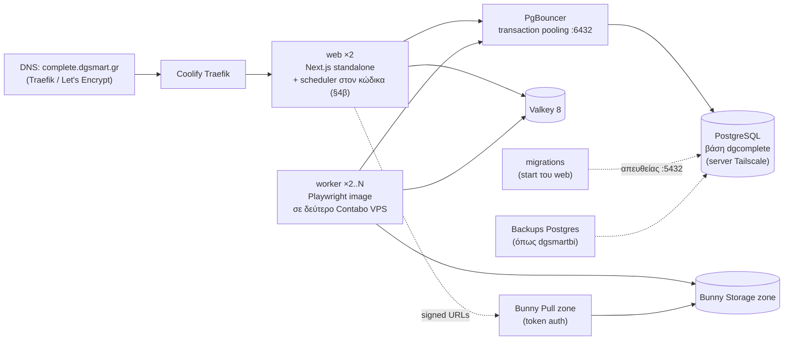

# 10 — Deployment (Docker + Coolify)

Ακολουθούμε το deploy του dgsmartbi (`docs/DEPLOY.md` του repo: Coolify, Dockerfile με Next.js standalone και migrations στο start, Postgres μέσω Tailscale), με τρεις προσθήκες: **worker**, **Valkey** και **PgBouncer** μπροστά στον Postgres.

## 1. Τοπολογία παραγωγής



| Υπηρεσία | Πόροι (αρχικά) | Σημειώσεις |
|---|---|---|
| web | 2 × (1 vCPU, 1 GB) | `output: "standalone"`, health `/api/health` (υπάρχει στο dgsmartbi). ο scheduler τρέχει σε όλα τα replicas με κλείδωμα ανά εργασία στη βάση (§4β) |
| worker | 2 × (4 vCPU, 8 GB) σε ξεχωριστό VPS (Coolify multi‑server) | base `mcr.microsoft.com/playwright:v<ίδια έκδοση>-noble`, non‑root, `--shm-size=1g`, σταθερή IP για whitelisting |
| PostgreSQL | **υπάρχων server του dgsmartbi (`100.70.50.43`)**, ξεχωριστή βάση | νέα βάση `dgcomplete` + χρήστες `dgcomplete_app` (χωρίς ownership πινάκων) και `dgcomplete_migrator` |
| ClamAV | sidecar του worker (`clamav/clamav`), 1 GB RAM | Έλεγχος ιών στα αρχεία του API (docs/21 §5) |
| **PgBouncer** | 0.5 vCPU, 256 MB, δίπλα στον Postgres server (ή ως Coolify service) | `pool_mode = transaction`, `max_prepared_statements = 200` (PgBouncer ≥ 1.21), `default_pool_size = 20`, `max_client_conn = 500`, auth με `auth_query` / `userlist.txt` για `dgcomplete_app`· οι migrations **δεν** περνούν από PgBouncer |
| Valkey | 1 GB, AOF on | Coolify one‑click |
| Bunny | Storage zone + Pull zone | εκτός Coolify |

## 2. Dockerfile (επέκταση του dgsmartbi)

Το Dockerfile του dgsmartbi έχει stages `deps → build → migrator → runner` με `node:22-bookworm-slim`. Αλλαγές:
- `NODE_VERSION=24-bookworm-slim`.
- Νέο stage **`worker`**: `FROM mcr.microsoft.com/playwright:v1.xx.x-noble`, αντιγράφει `node_modules`, `lib/`, `worker/`, `lib/generated/prisma`, εντολή `node --conditions=react-server --import tsx worker/index.ts` (ή προ‑compiled με `tsup` → `node --conditions=react-server dist/worker.js`).
- Coolify: δύο applications από το ίδιο repo με διαφορετικό **Docker target** (`runner` για web, `worker` για worker).
- CI ελέγχει ότι η έκδοση του `playwright` package == tag του image.
- `docker-compose.dev.yml` για τοπική ανάπτυξη: postgres, **pgbouncer** (ίδια ρύθμιση με την παραγωγή), valkey, mailpit, sandbox (το storage σε dev είναι ο local driver).

## 3. Environment variables

```
# από το dgsmartbi
DATABASE_URL=postgresql://dgcomplete_app:…@100.70.50.43:6432/dgcomplete   # μέσω PgBouncer
BETTER_AUTH_SECRET=…            BETTER_AUTH_URL=https://complete.dgsmart.gr
DATA_ENCRYPTION_KEYS=k1:…       # AES-256-GCM keyring (rotation: νέο κλειδί πρώτο)
SEED_ADMIN_EMAIL=… SEED_ADMIN_PASSWORD=… SEED_ADMIN_NAME=…
CRON_SECRET=…                   SCHEDULER=          # off μόνο για debugging· οι εργασίες ορίζονται στο lib/jobs/registry.ts, ΟΧΙ στο Coolify
# Mailgun / SoftOne DGsoft (χρεώσεις, συγχρονισμοί): όπως στο dgsmartbi (ρυθμίζονται και από το /admin/settings)

# νέα
DATABASE_URL_MIGRATOR=postgresql://dgcomplete_migrator:…@100.70.50.43:5432/dgcomplete   # απευθείας, χωρίς PgBouncer
DB_POOL_MAX=10                  # pool του @prisma/adapter-pg ανά process (web 10, worker 5)
REDIS_URL=redis://valkey:6379
MICROSOFT_CLIENT_ID=…  MICROSOFT_CLIENT_SECRET=…  MICROSOFT_TENANT_ID=common
STORAGE_DRIVER=bunny            # bunny | local
BUNNY_STORAGE_ZONE=dg-complete
BUNNY_STORAGE_REGION=           # κενό = Falkenstein (storage.bunnycdn.com), αλλιώς π.χ. "uk", "se"
BUNNY_STORAGE_ACCESS_KEY=…      # password του storage zone — ΜΟΝΟ server/worker
BUNNY_PULLZONE_HOST=dg-complete-artifacts.b-cdn.net
BUNNY_TOKEN_KEY=…               # security key του Token Authentication του pull zone
API_KEY_PEPPER=…                # προαιρετικό, επιπλέον στο SHA-256 των API keys
RECORDER_JWT_SECRET=…
WORKER_CONCURRENCY=8
```
Επικύρωση με zod στο `lib/env.ts` — web και worker δεν ξεκινούν αν λείπει κάτι.

## 4. Coolify — βήματα

1. Project «DG Complete», environments `staging` / `production`.
2. Νέα βάση `dgcomplete` στον Postgres server + κανόνες `pg_hba.conf` για τις IPs του Coolify (όπως στο DEPLOY.md του dgsmartbi).
3. **PgBouncer** για τη βάση `dgcomplete` (port 6432, transaction mode)· κανόνας `pg_hba.conf` ώστε ο `dgcomplete_app` να συνδέεται μόνο από τον PgBouncer και ο `dgcomplete_migrator` από τις IPs του Coolify.
4. Valkey από one‑click resource.
5. Application **web** (Dockerfile target `runner`), domain `complete.dgsmart.gr`, health check `/api/health`, 2 replicas.
6. Application **worker** (target `worker`) στον δεύτερο server, χωρίς domain.
7. Migrations: γίνονται στο start του web container (pattern dgsmartbi) με `DATABASE_URL_MIGRATOR`.
8. Bunny: δημιουργία storage zone + pull zone, ενεργοποίηση Token Authentication, CORS για το domain της εφαρμογής, αντιγραφή κλειδιών στα env.

## 4α. PgBouncer — κανόνες για τον κώδικα

Σε **transaction pooling** κάθε transaction μπορεί να πάει σε άλλη σύνδεση του Postgres. Γι' αυτό:
- **RLS context μόνο τοπικά στο transaction:** το `withTenantTx` κάνει `set_config('app.tenant_id', …, true)` (το `true` = transaction‑local) μέσα στο ίδιο `$transaction`. Ποτέ `SET` σε επίπεδο session.
- **Όχι session advisory locks** (`pg_advisory_lock`)· ο scheduler κλειδώνει με `lockedUntil` στον πίνακα `ScheduledTask` (§4β).
- **Όχι `LISTEN/NOTIFY`** — τα live events πάνε από Valkey pub/sub (docs/01 §6).
- **Prepared statements:** ο `pg` driver του `@prisma/adapter-pg` λειτουργεί με PgBouncer ≥ 1.21 και `max_prepared_statements > 0`. Αν ο PgBouncer είναι παλαιότερος, ρύθμιση adapter χωρίς named statements.
- **Migrations και `prisma studio`** πάντα με `DATABASE_URL_MIGRATOR` απευθείας στο 5432 (`prisma.config.ts` → `datasource.url = env("DATABASE_URL_MIGRATOR")` για το CLI· το runtime client διαβάζει `DATABASE_URL`).
- **Μέγεθος pools:** Σ (replicas × `DB_POOL_MAX`) ≤ `max_client_conn`· ο PgBouncer κρατά λίγες πραγματικές συνδέσεις (`default_pool_size`) προς τον Postgres, που μοιράζεται με το dgsmartbi.
- **Μακριές εργασίες του worker:** κανένα transaction δεν μένει ανοιχτό όσο τρέχει ο browser· ο worker γράφει RunStep/RunLog σε σύντομα transactions ανά βήμα.

## 4β. Προγραμματισμένες εργασίες — στον κώδικα, όχι στο Coolify

**Κανόνας:** καμία εργασία δεν ορίζεται ως Scheduled Task του Coolify ή ως crontab στον server. Όλες οι περιοδικές εργασίες ορίζονται στον κώδικα, μπαίνουν στο git, περνούν από code review και έχουν tests. Το Coolify μόνο τρέχει τα containers.

**Μηχανισμός (επέκταση του scheduler του dgsmartbi):**
- `instrumentation.ts` → `lib/scheduler.ts` ξεκινά tick κάθε λεπτό μέσα στο web container (όπως σήμερα στο dgsmartbi), που καλεί το `/api/internal/cron/run` με `CRON_SECRET`.
- **Μητρώο εργασιών `lib/jobs/registry.ts`:** μία λίστα με όλες τις εργασίες: `name`, `schedule` (cron έκφραση, ζώνη `Europe/Athens`), `handler`, `timeoutMs`, `mode` (`inline` για ελαφριές, `enqueue` για βαριές που πάνε στην ουρά `maintenance` του BullMQ και τις εκτελεί ο worker).
- **Κατάσταση και κλείδωμα στη βάση:** πίνακας `ScheduledTask` (`name` unique, `nextRunAt`, `lastRunAt`, `lastStatus`, `lastError`, `lockedUntil`, `lockedBy`). Ένα replica παίρνει την εργασία με `UPDATE … SET "lockedUntil" = now() + timeout WHERE name = $1 AND ("lockedUntil" IS NULL OR "lockedUntil" < now()) RETURNING` — λειτουργεί πίσω από PgBouncer (ένα statement, χωρίς session lock) και με πολλά replicas, οπότε το `SCHEDULER=off` δεν είναι πια υποχρεωτικό.
- Οι συγχρονισμοί SoftOne του dgsmartbi (`SyncJob`, `runDueJobs`) μένουν όπως είναι και καλούνται από το ίδιο tick.
- Η σελίδα `/admin/settings/scheduler` δείχνει όλες τις εργασίες του μητρώου, τελευταία/επόμενη εκτέλεση, σφάλματα και κουμπί «Εκτέλεση τώρα» (audit `scheduler.run_now`). Αλλαγή ωραρίου = αλλαγή στον κώδικα.
- Τα ωράρια ελέγχονται με test (`registry.test.ts`: έγκυρες cron εκφράσεις, μοναδικά ονόματα, κάθε handler υπάρχει).

| Εργασία | Ωράριο (Europe/Athens) | Τρόπος | Τι κάνει |
|---|---|---|---|
| `softone.sync` | κάθε λεπτό (ανά `SyncJob.intervalMinutes`) | inline | Συγχρονισμοί πελατών SoftOne → tenants (dgsmartbi) |
| `softone.payments` | κάθε ώρα | inline | Ανοιχτά υπόλοιπα παραστατικών → `Payment.s1OpenAmount` (docs/14 §5) |
| `billing.monthly-grant` | 1η του μήνα 00:05 | inline | Μηνιαία χορήγηση εκτελέσεων (`grant:<tenant>:<YYYY-MM>`) |
| `billing.close-month` | 1η του μήνα 02:00 | inline | Overage εκτελέσεων + χρέωση `AI_USAGE` → SALDOC στο SoftOne |
| `billing.dunning` | καθημερινά 09:00 | inline | Ειδοποίηση στις 15 ημέρες, πρόταση αναστολής στις 30 |
| `usage.rollup` | κάθε 5′ | inline | `UsageDaily`, ειδοποιήσεις 80% / 100% πακέτου και ορίου AI |
| `fx.rates` | καθημερινά 06:00 | inline | Ισοτιμία USD→EUR για τη χρέωση AI |
| `retention.artifacts` | καθημερινά 03:00 | enqueue | Διαγραφή αρχείων από Bunny Storage σε batches |
| `retention.logs` | καθημερινά 03:30 | enqueue | Διαγραφή `RunLog` / `RunStep` πέρα από το `logRetentionDays` |
| `partitions.maintain` | 25η του μήνα 04:00 | inline | Partition επόμενου μήνα, `DROP` παλιών (docs/03) |
| `sessions.cleanup` | κάθε 15′ | enqueue | Λήξη `BrowserSession`, κλείσιμο ορφανών contexts |
| `credentials.expiry` | καθημερινά 08:00 | inline | Υπενθύμιση λήξης εξουσιοδότησης δικαιούχων (docs/18) |
| `health.targets` | ωριαία 07:00–22:00 + 03:00 (ανά `TargetSystem.healthSchedule`) | enqueue | Health runs ανά σύστημα με δοκιμαστικό δικαιούχο, χωρίς υποβολή (docs/23 §1) |
| `incidents.evaluate` | κάθε λεπτό | inline | Κανόνες incidents, κλιμάκωση ειδοποιήσεων, αυτόματη παύση / HALF_OPEN μεθόδων (docs/23) |
| `runs.held-expiry` | κάθε 15′ | inline | HELD runs άνω του `heldMaxHours` → CANCELLED χωρίς χρέωση (docs/23 §4) |
| `retention.files` | καθημερινά 03:45 | enqueue | Διαγραφή FileObjects: αχρησιμοποίητα 7 ημ., 24h μετά την επιτυχία (docs/21 §6) |
| `files.av-signatures` | κάθε 2 ώρες | enqueue | `freshclam` για τον ClamAV του worker (docs/21 §5) |
| `webhooks.retry-sweep` | κάθε 10′ | enqueue | Επανατοποθέτηση webhook deliveries που κόλλησαν |
| `jobs.stuck-sweep` | κάθε 5′ | inline | Runs σε `RUNNING` χωρίς heartbeat > 10′ → `FAILED` (`E_WORKER_LOST`), χωρίς χρέωση |
| `schedules.user` (φάση 3) | κάθε λεπτό | enqueue | Προγραμματισμένες εκτελέσεις μεθόδων που ορίζουν οι tenants (`Schedule`) |

## 5. CI (GitHub Actions)

`lint → typecheck → unit (vitest) → integration (testcontainers: postgres, valkey) → e2e (sandbox + worker + web, local storage driver) → build images (web, worker) → push GHCR → Coolify webhook (staging) → έγκριση → production`. Το extension χτίζεται και γίνεται zip σε κάθε tag.

## 6. Extension

Chrome Web Store (unlisted) + Edge Add‑ons· για εταιρικούς πελάτες εγκατάσταση με policy (`ExtensionInstallForcelist`).
