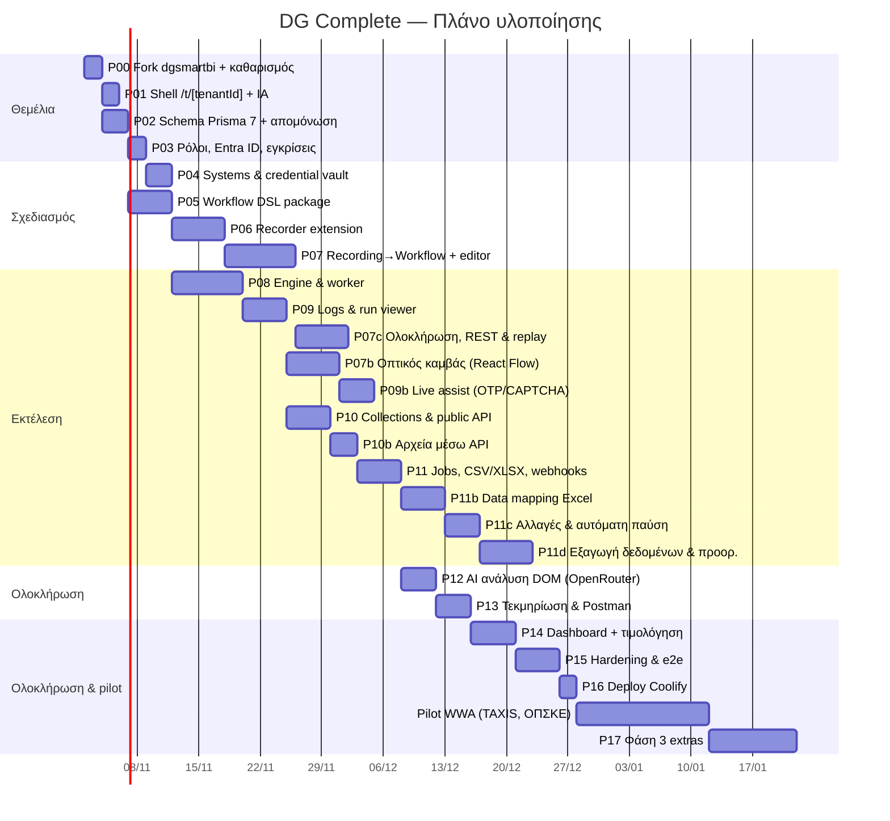

# 11 — Roadmap & φάσεις υλοποίησης

Κάθε φάση αντιστοιχεί σε ένα prompt στο `prompts/`. Εκτίμηση για 1 developer με Claude Code.

## Milestones

| Milestone | Περιλαμβάνει | Demo κριτήριο |
|---|---|---|
| **M1 — Θεμέλια** (P00–P03) | Fork dgsmartbi, νέο IA, ρόλοι, Entra ID | Δύο tenants· ο ένας δεν βλέπει δεδομένα του άλλου (tests απομόνωσης πράσινα) |
| **M2 — Πρώτη εκτέλεση** (P04, P05, P08) | Χειρόγραφο JSON workflow εκτελείται στο sandbox | Run με screenshot σε σκόπιμο σφάλμα |
| **M3 — Record to run** (P06, P07, P07c, P07b, P09, P09b) | Καταγραφή → editor/καμβάς → test run → viewer με live κατάσταση βημάτων | Καταγραφή φόρμας sandbox και επιτυχής εκτέλεση σε < 15′ |
| **M4 — API** (P10, P10b, P11, P11b, P11c, P11d) | Μέθοδοι, API keys, αρχεία, batch με data mapping, webhooks, incidents/παύση | Excel WWA (αιτήματα με παραστατικά + ZIP) → runs με report πάνω στο αρχικό αρχείο· αλλαγή στο sandbox → παύση και επανεκκίνηση χωρίς απώλεια |
| **M4b — Νοημοσύνη & τεκμηρίωση** (P12–P13) | OpenRouter στην καταγραφή/διάγνωση, τεκμηρίωση συστημάτων, Postman | Τεκμηρίωση «Sandbox ERP» με στιγμιότυπα + Postman που τρέχει |
| **M5 — Production** (P14–P16) | Dashboard, τιμολόγηση ανά εκτέλεση & πακέτα, hardening, deploy | Pilot WWA σε TAXIS & ΟΠΣΚΕ (docs/18) με πραγματική χρέωση μέσω SoftOne |
| **M6 — Φάση 3** (P17) | Remote recorder, MCP server, προγραμματισμένες εκτελέσεις, visual change detection | |

## Backlog φάσης 3+
- Remote browser recorder (CDP screencast).
- AI locator repair & «περιέγραψε τη ροή με φυσική γλώσσα» μέσω εταιρικού AI gateway.
- MCP server για τις μεθόδους.
- Προγραμματισμένες εκτελέσεις (cron) και triggers από email/αρχεία σε φάκελο Synology.
- Visual regression: σύγκριση screenshot της σελίδας με το baseline της καταγραφής για έγκαιρη ανίχνευση αλλαγών UI.
