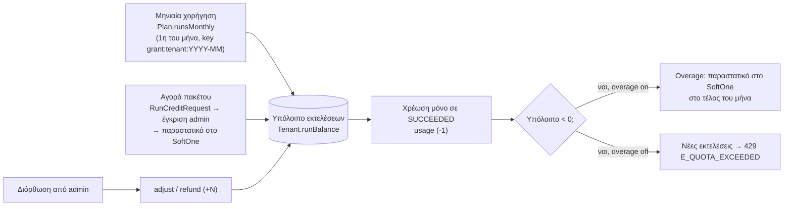
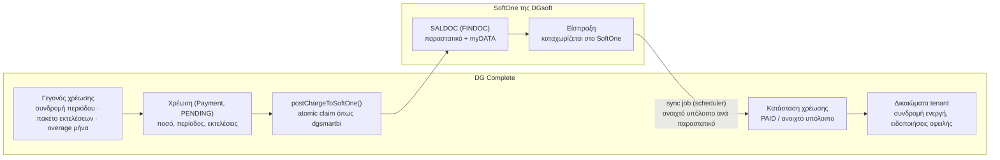

# 14 — Τιμολόγηση: ανά εκτέλεση και πακέτα

**Μοντέλο:** κάθε tenant έχει **πακέτο** (Plan) με μηνιαία ή ετήσια συνδρομή που περιλαμβάνει **Χ εκτελέσεις ανά μήνα**. Πάνω από αυτές χρεώνεται **ανά εκτέλεση** (overage) ή αγοράζονται **πακέτα επιπλέον εκτελέσεων**. Υλοποιείται με το ίδιο pattern που έχει ήδη το dgsmartbi για τα AI tokens (`AiTokenLedger` / `AiTokenRequest`). **Χρεώσεις, παραστατικά και πληρωμές γίνονται στο SoftOne της DGsoft** (§5).

## 1. Τι μετράει ως «εκτέλεση»

| Περίπτωση | Χρέωση |
|---|---|
| Run που ολοκληρώθηκε `SUCCEEDED` | 1 εκτέλεση |
| Run `FAILED` για **οποιονδήποτε** λόγο (δεδομένα, τρίτο σύστημα, πλατφόρμα) | 0 — **χρεώνονται μόνο οι επιτυχίες** |
| Run `NEEDS_ATTENTION` που ολοκληρώθηκε από χειριστή με επιτυχία | 1 εκτέλεση |
| Αυτόματες νέες προσπάθειες του ίδιου run | 0 — χρεώνεται μόνο το τελικό αποτέλεσμα |
| Χειροκίνητη επανάληψη (νέο run) | 1 εκτέλεση μόνο αν πετύχει |
| Απορρίψεις validation πριν την ουρά (`E_INPUT_VALIDATION`) | 0 |
| Ακύρωση πριν ξεκινήσει | 0 |
| Run `HELD` (μέθοδος σε παύση λόγω incident, docs/23) ή που έληξε σε αναμονή | 0 |
| Health runs (`trigger = HEALTH`) και runs που απέτυχαν σε έλεγχο αρχείου (`E_FILE_INFECTED`, `E_FILE_INVALID`) | 0 |
| Δοκιμαστικές εκτελέσεις από τον editor (`UI_TEST`) | 0, έως `Plan.freeTestRunsDaily` (default 50/ημέρα) |

> Προαιρετικά (ρύθμιση πλάνου) **βαρύτητα ανά διάρκεια**: run > 5 λεπτά browser = 2 εκτελέσεις. Default: off.

## 2. Ροή μονάδων (ledger)



- `RunCreditLedger`: `delta`, `balanceAfter`, `kind` (`grant` | `topup` | `gift` | `usage` | `refund` | `adjust` | `overage_invoice`), `runId?`, `key` unique (idempotency: `usage:<runId>`, `grant:<tenant>:<YYYY-MM>`).
- **Δώρο εκτελέσεων (`gift`):** ο **SUPER_ADMIN** δίνει δωρεάν εκτελέσεις σε έναν tenant (π.χ. pilot, αποζημίωση, προωθητική ενέργεια) από τη σελίδα του tenant στο `/admin/tenants/[id]`: πλήθος, αιτιολογία (υποχρεωτική), προαιρετική λήξη. Δεν δημιουργεί χρέωση ούτε παραστατικό, καταγράφεται στο audit (`credits.gifted`) και ο tenant το βλέπει στο ledger ως «Δώρο». Αντίστοιχα δίνει **πίστωση AI** σε ευρώ (`AiCreditLedger` kind `gift`) που συμψηφίζεται στη μηνιαία χρέωση AI (§7).
- **Μόνο επιτυχίες:** η χρέωση γίνεται μόνο στη μετάβαση σε `SUCCEEDED`. Για να μη γίνεται κατάχρηση με μαζικές αποτυχημένες κλήσεις, ισχύει όριο αποτυχιών ανά tenant (`Plan.maxFailedRunsDaily`, default 10× του ημερήσιου μέσου όρου επιτυχιών ή 500) που οδηγεί σε 429 `E_FAILURE_LIMIT` και ειδοποίηση.
- Η χρέωση γίνεται **atomic** στην ίδια transaction με τη μετάβαση του run σε `SUCCEEDED`: `UPDATE tenant SET "runBalance" = "runBalance" - 1 ... RETURNING` + insert ledger (με `key = usage:<runId>` ώστε ποτέ διπλή χρέωση).
- **Κράτηση πριν την ουρά:** στο enqueue ελέγχουμε `runBalance - activeRuns > 0` ή ότι το overage είναι ενεργό· αλλιώς 429. Για batch jobs ο έλεγχος γίνεται για όλο το job (`totalItems`) και το UI δείχνει «Θα χρησιμοποιηθούν 1.000 εκτελέσεις — υπόλοιπο 640 + overage».
- Οι μονάδες της μηνιαίας χορήγησης **δεν μεταφέρονται** στον επόμενο μήνα (ρυθμιζόμενο ανά πακέτο: `rollover: false`)· τα αγορασμένα πακέτα **δεν λήγουν** για 12 μήνες.

## 3. Πεδία που προστίθενται

```prisma
model Plan {
  // … υπάρχοντα πεδία dgsmartbi (name, services[], period, price, active, sortOrder)
  runsMonthly         Int      @default(0)      // εκτελέσεις που περιλαμβάνονται ανά μήνα
  overageEnabled      Boolean  @default(false)
  overagePricePerRun  Decimal? @db.Decimal(10, 4) // € ανά εκτέλεση πέρα από το υπόλοιπο
  freeTestRunsDaily   Int      @default(50)
  maxConcurrentRuns   Int      @default(2)
  maxWorkflows        Int      @default(10)
  artifactRetentionDays Int    @default(30)
  logRetentionDays    Int      @default(90)
}

model Tenant {
  // …
  runBalance          Int      @default(0)
}

model RunCreditPack {           // καταλόγος πακέτων επιπλέον εκτελέσεων (Ρυθμίσεις → Πακέτα εκτελέσεων)
  id        String  @id @default(cuid())
  name      String  // «1.000 εκτελέσεις»
  runs      Int
  priceEur  Decimal @db.Decimal(12, 2)
  active    Boolean @default(true)
  sortOrder Int     @default(0)
}
```
`RunCreditLedger` και `RunCreditRequest`: βλ. `docs/schema-additions.prisma`.

## 4. Παραδείγματα πακέτων (προς επικύρωση τιμών)

| Πακέτο | Εκτελέσεις/μήνα | Ταυτόχρονες | Συλλογές/ροές | Διατήρηση στιγμιοτύπων | Overage |
|---|---|---|---|---|---|
| Starter | 500 | 2 | 5 ροές | 30 ημέρες | — |
| Business | 5.000 | 5 | 25 ροές | 60 ημέρες | ναι |
| Enterprise | 25.000 | 15 | απεριόριστες | 180 ημέρες | ναι |

Πακέτα επιπλέον εκτελέσεων: 1.000 / 5.000 / 20.000. Τα όρια εγκρίθηκαν στις 25/10· οι τιμές ορίζονται από το admin (`/admin/plans`, `/admin/settings/run-packs`).

## 5. Χρεώσεις, πληρωμές, παραστατικά: στο SoftOne

**Αρχή:** το DG Complete **μετρά** τη χρήση και **δημιουργεί χρεώσεις**· τα **παραστατικά εκδίδονται στο SoftOne της DGsoft** (και από εκεί στο myDATA) και οι **πληρωμές καταχωρίζονται στο SoftOne**. Το DG Complete δεν εισπράττει χρήματα και δεν εκδίδει παραστατικά — μόνο διαβάζει πίσω την κατάστασή τους. Κάθε tenant αντιστοιχεί σε πελάτη της DGsoft (`Tenant.s1Trdr`, από τον συγχρονισμό πελατών).



| Γεγονός | Πότε | Τι στέλνεται στο SoftOne | Πότε ενεργοποιείται στο DG Complete |
|---|---|---|---|
| Συνδρομή πακέτου | Έναρξη/ανανέωση περιόδου (μηνιαία ή ετήσια) | SALDOC με γραμμή υπηρεσίας του πακέτου | Αμέσως (επέκταση `subscriptionEndsAt`)· αν μείνει απλήρωτο πέρα από `graceDays` → ειδοποίηση και μετά αναστολή |
| Πακέτο εκτελέσεων | Έγκριση αιτήματος από admin | SALDOC με γραμμή «Πακέτο Ν εκτελέσεων» | `topup` στο ledger με την έγκριση (default) ή μετά την είσπραξη (ρύθμιση `topupOnPayment` ανά tenant) |
| Overage μήνα | Κλείσιμο μήνα (scheduler, 1η του επόμενου) | SALDOC «Επιπλέον εκτελέσεις Οκτωβρίου 2026: 312» × τιμή ανά εκτέλεση | Μηδενισμός αρνητικού υπολοίπου με `overage_invoice` |

**Υλοποίηση πάνω στο dgsmartbi:**
- Επαναχρησιμοποιούμε το μοντέλο `Payment` ως **χρέωση**: `status = PENDING` όταν δημιουργείται, `s1Status/s1Findoc/s1Fincode` από την αποστολή. Προσθέτουμε πεδία `kind` (`SUBSCRIPTION` | `RUN_PACK` | `OVERAGE`), `periodFrom`, `periodTo`, `runs`, `s1OpenAmount`, `s1CheckedAt`. Το `method` γίνεται προαιρετικό (η πληρωμή γίνεται στο SoftOne).
- Το `postPaymentToSoftOne()` γενικεύεται σε `postChargeToSoftOne()` με γραμμή υπηρεσίας ανά είδος χρέωσης (ρύθμιση `serviceMtrl` ανά `kind` στο `/admin/settings/billing`) — ίδιο atomic claim και ίδιος έλεγχος «διαβάζω πίσω το παραστατικό».
- **Πληρωμές από το SoftOne:** νέο sync job (στο υπάρχον σύστημα συγχρονισμών, προορισμός `APP`) που διαβάζει για τα `s1Findoc` των ανοιχτών χρεώσεων το **ανοιχτό υπόλοιπο** του παραστατικού. Όταν μηδενιστεί → `status = PAID`, `paidAt`. Ποιος πίνακας/πεδία του SoftOne δίνουν το ανοιχτό υπόλοιπο ανά παραστατικό επιβεβαιώνεται με το skill `softone` στο P14.
- **Online πληρωμή (Viva) αφαιρείται** από το DG Complete· αν χρειαστεί στο μέλλον, γίνεται μέσω SoftOne.
- **Οφειλές:** ρύθμιση `graceDays` (default 15). Απλήρωτη χρέωση μετά το `graceDays` → ειδοποίηση στον TENANT_ADMIN· μετά από `graceDays × 2` → ο tenant περνά σε `SUSPENDED` (νέες εκτελέσεις 403, τα δεδομένα μένουν). Η αναστολή γίνεται πάντα με επιβεβαίωση platform admin.
- **Ο tenant βλέπει** στη σελίδα «Χρήση & πακέτο» τις χρεώσεις του με αριθμό παραστατικού του SoftOne (`s1Fincode`) και κατάσταση πληρωμής (εξοφλημένο / ανοιχτό υπόλοιπο).

## 6. Οθόνες

- **Tenant → Χρήση & πακέτο:** υπόλοιπο εκτελέσεων, κατανάλωση μήνα (γράφημα ανά ημέρα), ιστορικό ledger, «Αγορά πακέτου», **χρεώσεις με αριθμό παραστατικού SoftOne και κατάσταση πληρωμής**.
- **Admin → Πακέτα:** νέα πεδία του Plan. **Admin → Πακέτα εκτελέσεων:** κατάλογος packs. **Admin → Αιτήματα:** έγκριση αιτημάτων πακέτων (ίδιο UI με τα AI token requests). **Admin → Χρεώσεις** (το `/admin/payments` του dgsmartbi): όλες οι χρεώσεις, κατάσταση αποστολής στο SoftOne, επανάληψη αποστολής, ανοιχτά υπόλοιπα.
- **Ειδοποιήσεις:** email στο 80% και 100% της μηνιαίας κατανάλωσης (Mailgun templates).

## 7. API

- Κάθε απάντηση `/api/v1` περιέχει header `X-DGComplete-Runs-Remaining`.
- `GET /api/v1/usage` → `{ balance, monthUsed, monthIncluded, overageEnabled }`.

## 7. Χρέωση AI (ξεχωριστά από τις εκτελέσεις)

Το AI **δεν** περιλαμβάνεται στις εκτελέσεις ούτε σε προπληρωμένα tokens. Χρεώνεται **ξεχωριστά**, στο **πραγματικό κόστος OpenRouter + markup ανά πακέτο**:

| Πεδίο | Περιγραφή |
|---|---|
| `AiUsage.costUsd` | Κόστος της κλήσης όπως το επιστρέφει το OpenRouter (`usage.cost`) |
| `Plan.aiMarkupPct` | Ποσοστό markup του πακέτου (π.χ. Starter > Business > Enterprise — τιμές από DGsoft) |
| `AiUsage.billedAmount` | `costUsd × FX(USD→EUR) × (1 + aiMarkupPct/100)`, κλειδωμένο τη στιγμή της κλήσης |
| `Tenant.settings.ai.monthlyCostCap` | Προαιρετικό ανώτατο ποσό/μήνα· στο 80% ειδοποίηση, στο 100% οι εργασίες AI σταματούν |

- Στο τέλος του μήνα το σύνολο `billedAmount` γίνεται **ξεχωριστή χρέωση** `Payment.kind = AI_USAGE` προς το SoftOne (ίδιο `postChargeToSoftOne`, δικό του είδος στο SALDOC).
- Η ισοτιμία USD→EUR αποθηκεύεται ανά ημέρα (`FxRate`) ώστε η χρέωση να είναι αναπαραγώγιμη.
- Ο tenant βλέπει στη σελίδα Χρήση: κλήσεις AI ανά εργασία, κόστος μήνα μέχρι σήμερα, όριο.
- Τα δώρα AI του SUPER_ADMIN γίνονται ως **πίστωση ποσού** (`AiCreditLedger` kind `gift`) που συμψηφίζεται στη μηνιαία χρέωση.
- Κλήσεις που κάνει η πλατφόρμα για δική της διάγνωση δεν χρεώνονται.
