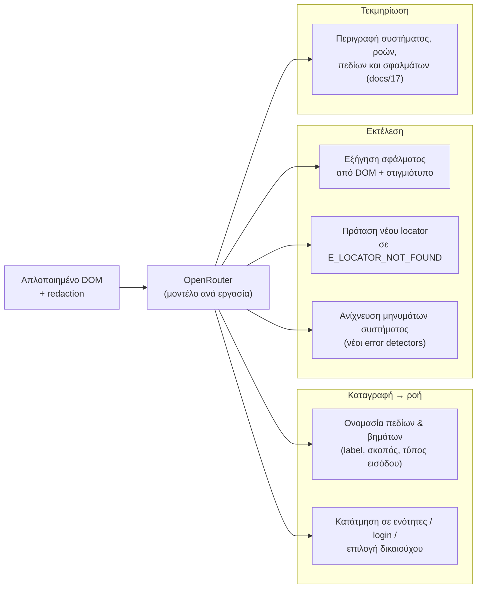

# 16 — Ανάλυση DOM με AI (OpenRouter)

**Απόφαση:** Το DG Complete χρησιμοποιεί **OpenRouter** όπου ο κανονικός (deterministic) κώδικας δεν αρκεί για να καταλάβει μια σελίδα. Η υποδομή υπάρχει ήδη στο dgsmartbi: `lib/openrouter.ts`, `AiSettings` (κλειδί, μοντέλα), `AiUsage` — τα ενεργοποιούμε στο DG Complete. Το ledger AI tokens (`AiTokenLedger`) **δεν** χρησιμοποιείται για χρέωση: το AI χρεώνεται ξεχωριστά σε κόστος + markup πακέτου (docs/14 §7).

## 1. Πού χρησιμοποιείται

| Εργασία | Πότε τρέχει | Είσοδος | Έξοδος | Εφαρμογή |
|---|---|---|---|---|
| `labelFields` | Compile καταγραφής | Απλοποιημένο DOM φόρμας + events | Ελληνικά labels, τύποι, `format` (π.χ. `afm-gr`, `iban`), περιγραφές εισόδων | Προτάσεις στο draft — ο σχεδιαστής εγκρίνει |
| `segmentFlow` | Compile καταγραφής | Λίστα βημάτων + URLs | Ομάδες (login, επιλογή δικαιούχου, φόρμα, υποβολή), commit point | Προτάσεις στο draft |
| `explainFailure` | Μετά από αποτυχία (κατ' επιλογή, ή αυτόματα για `E_LOCATOR_NOT_FOUND`/`E_ASSERTION_FAILED`) | DOM σφάλματος + στιγμιότυπο στοιχείου + βήμα | Εξήγηση στα ελληνικά «τι άλλαξε / τι να ελέγξεις» | Εμφανίζεται στο run viewer |
| `suggestNaming` | «Ολοκληρώθηκε» καταγραφής (docs/24 §4) | Headings, breadcrumb, κείμενα κουμπιών/μηνυμάτων, intent — χωρίς τιμές πεδίων | Όνομα κίνησης, slug πόρου, όνομα κλειδιού | Πρόταση που διορθώνει ο χρήστης |
| `suggestMapping` | Νέο Excel χωρίς πρότυπο (docs/20 §7) | Επικεφαλίδες + έως 5 δείγματα τιμών ανά στήλη με redaction + inputSchema | Προτεινόμενα πεδία, ομαδοποίηση, credentialRef, μετασχηματισμοί | Πρόταση που αποδέχεται ο χρήστης |
| `suggestLocator` | `E_LOCATOR_NOT_FOUND` | Περιγραφή στοιχείου από την καταγραφή + νέο DOM | 1–3 υποψήφιοι locators με αιτιολόγηση | **Μόνο πρόταση** σε νέο draft· ποτέ αυτόματα σε δημοσιευμένη έκδοση |
| `detectMessages` | Δοκιμαστικές εκτελέσεις | DOM μετά την υποβολή | Selectors μηνυμάτων λάθους/επιτυχίας | Προτάσεις για τους error detectors του συστήματος |
| `writeDocs` | Δημοσίευση έκδοσης / χειροκίνητα | Ροή, βήματα, thumbnails, σφάλματα | Κείμενα τεκμηρίωσης συστήματος (docs/17) | Πρόχειρο κείμενο που επεξεργάζεται ο σχεδιαστής |

## 2. Κανόνες

- **Redaction πριν φύγει οτιδήποτε:** αφαιρούνται τιμές πεδίων (κρατιέται μόνο η δομή: tag, role, label, name, placeholder), κωδικοί, ΑΦΜ/ΑΜΚΑ/IBAN/emails με regex, cookies, tokens. Τα στιγμιότυπα στέλνονται **μόνο** masked (ίδιο mask με το docs/08) και μόνο αν το επιτρέπει η ρύθμιση `ai.sendScreenshots` του tenant (default: όχι για TAXIS).
- **Απλοποιημένο DOM:** `lib/engine/dom-simplify.ts` — μόνο ορατά στοιχεία φόρμας/κουμπιά/headings/μηνύματα, με σταθερά ids, max ~30k χαρακτήρες· ποτέ ολόκληρη η σελίδα.
- **Μοντέλα ανά εργασία** στο `AiSettings` (π.χ. γρήγορο μοντέλο για `labelFields`, ισχυρότερο για `suggestLocator`/`explainFailure`), με fallback.
- **Δομημένη έξοδος:** κάθε κλήση με JSON schema (zod) — άκυρη απάντηση απορρίπτεται, δεν μαντεύουμε.
- **Χρέωση:** **ξεχωριστά** από τις εκτελέσεις, στο πραγματικό κόστος OpenRouter (`usage.cost`) + **markup ανά πακέτο** (`Plan.aiMarkupPct`), με μηνιαία χρέωση `AI_USAGE` στο SoftOne (docs/14 §7). Προαιρετικό μηνιαίο όριο κόστους ανά tenant. Οι κλήσεις που κάνει η πλατφόρμα για δική της διάγνωση (π.χ. alerts) δεν χρεώνονται.
- **Ποτέ στην κρίσιμη διαδρομή εκτέλεσης:** μια εκτέλεση δεν περιμένει ποτέ το AI για να συνεχίσει· το AI προτείνει, ο άνθρωπος εγκρίνει.
- Audit κάθε κλήσης (`AiUsage`: εργασία, μοντέλο, tokens, διάρκεια, tenant, run/workflow).

## 3. Ρυθμίσεις tenant

`Tenant.settings.ai = { enabled: true, sendScreenshots: false, autoExplainFailures: true, monthlyCostCap?: number /* EUR */ }` — από τη σελίδα Ρυθμίσεις του tenant (TENANT_ADMIN).
