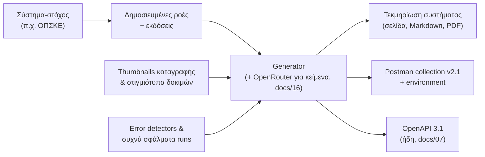

# 17 — Τεκμηρίωση ανά σύστημα & Postman collections

Για κάθε **σύστημα‑στόχο** που χαρτογραφείται (π.χ. TAXIS, ΟΠΣΚΕ) η πλατφόρμα παράγει **τεκμηρίωση** και **Postman collection**, ώστε ο πελάτης και οι integrators να ξέρουν τι κάνει κάθε μέθοδος χωρίς να ανοίξουν τον editor.

## 1. Τι παράγεται



### 1.1 Τεκμηρίωση συστήματος (`SystemDoc`)
Ενότητες:
1. **Επισκόπηση:** τι είναι το σύστημα, URLs, τρόπος σύνδεσης (π.χ. κωδικοί TaxisNet), ρόλοι/εξουσιοδοτήσεις που χρειάζονται, όρια (ταυτόχρονες συνδέσεις, ωράρια λειτουργίας).
2. **Ροές:** για κάθε δημοσιευμένη ροή — σκοπός, προϋποθέσεις, βήματα με **στιγμιότυπο ανά βήμα** (από την καταγραφή ή από το τελευταίο επιτυχημένο test run, masked), σημείο δέσμευσης (commit point).
3. **Πεδία εισόδου:** πίνακας `key · label · τύπος · υποχρεωτικό · format · παράδειγμα · περιγραφή` (από το `inputSchema`).
4. **Έξοδοι:** τι επιστρέφει (π.χ. αριθμός πρωτοκόλλου).
5. **Μηνύματα & σφάλματα:** κατάλογος γνωστών μηνυμάτων του συστήματος (error detectors + συχνότερα `targetMessage` των runs) με εξήγηση και ενέργεια.
6. **Μέθοδοι API:** endpoint, παράδειγμα κλήσης (curl, TypeScript), παράδειγμα απάντησης, webhooks.
7. **Ιστορικό εκδόσεων:** changelog, breaking changes.

Μορφές: σελίδα στο app (`/t/[tenantId]/targets/[id]/docs`), εξαγωγή **Markdown** και **PDF**, δημόσιο read‑only link με λήξη (για κοινοποίηση στον πελάτη/integrator). Τα κείμενα 1, 2, 5 τα γράφει πρώτα το AI (docs/16 `writeDocs`) και τα επιμελείται ο σχεδιαστής· τα 3, 4, 6, 7 παράγονται αυτόματα από τα δεδομένα.

**Αναπαραγωγή:** σε κάθε δημοσίευση έκδοσης ροής του συστήματος (νέα έκδοση `SystemDoc`, με διατήρηση των χειροκίνητων επεξεργασιών ανά ενότητα).

### 1.2 Postman collection
- Ένα collection **ανά συλλογή μεθόδων** και ένα **ανά σύστημα‑στόχο** (όλες οι μέθοδοι που αφορούν το σύστημα).
- Postman Collection **v2.1**: φάκελος ανά μέθοδο με requests `Run (async)`, `Run (sync)`, `Validate`, `Batch job`, `Get run`, `Get artifacts`· body = `example` των inputs· περιγραφές από την τεκμηρίωση· **saved example responses** (επιτυχία, `E_TARGET_VALIDATION`, 422).
- **Environment** αρχείο: `baseUrl = https://complete.dgsmart.gr/api/v1`, `apiKey` (κενό), `collection`, `idempotencyKey = {{$guid}}`.
- Auth: Bearer `{{apiKey}}` σε επίπεδο collection. Pre-request script που βάζει `Idempotency-Key`.
- Tests scripts: έλεγχος `status`, αποθήκευση `runId` σε μεταβλητή για το `Get run`.
- Λήψη από το UI (`.json`) και από το API: `GET /api/v1/collections/{c}/postman.json`, `GET /api/v1/targets/{slug}/postman.json`.
- Προαιρετικά (αν ρυθμιστεί Postman API key στο tenant): αυτόματο push στο workspace του πελάτη.

## 2. Μοντέλο δεδομένων

```prisma
model SystemDoc {
  id             String   @id @default(cuid())
  tenantId       String
  targetSystemId String
  version        Int
  status         String   @default("DRAFT") // DRAFT | PUBLISHED
  sections       Json     // { overview, flows[], fields[], outputs[], messages[], methods[], changelog[] } + manualEdits ανά ενότητα
  pdfPath        String?  // Bunny Storage
  shareToken     String?  @unique
  shareExpiresAt DateTime?
  generatedById  String?
  createdAt      DateTime @default(now())
  updatedAt      DateTime @updatedAt
  @@unique([targetSystemId, version])
  @@map("system_doc")
}
```

## 3. Υλοποίηση

- `lib/docs/build-system-doc.ts` — συλλογή δεδομένων + κλήση `writeDocs` + merge χειροκίνητων αλλαγών.
- `lib/docs/postman.ts` — από το OpenAPI της συλλογής (docs/07 §6) σε Postman v2.1 (με `openapi-to-postmanv2` ή δικό μας converter) + εμπλουτισμός με examples/tests.
- PDF: HTML render με DG στυλ → PDF με Playwright (`page.pdf()`) στον worker, αποθήκευση στο Bunny.
