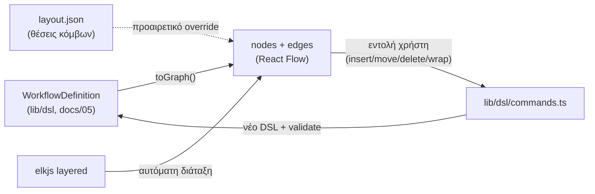
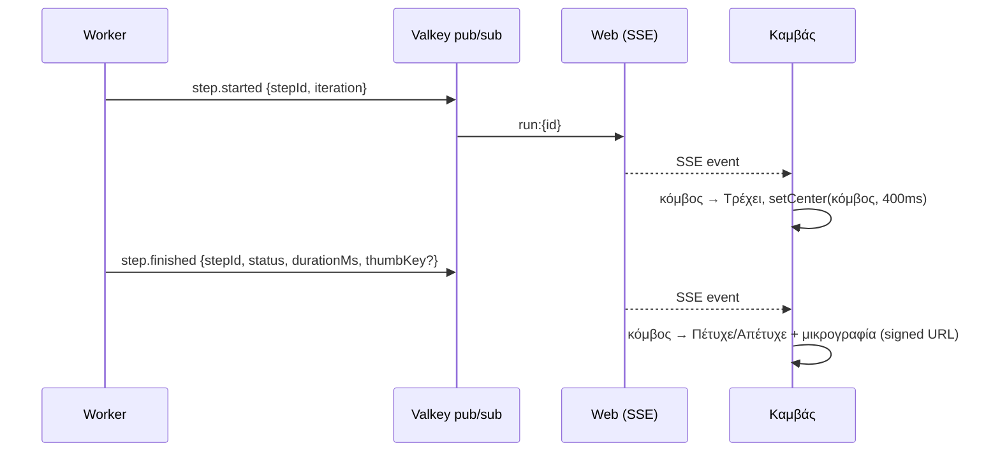

# 19 — Οπτικός καμβάς ροών (React Flow)

**Στόχος:** ο χρήστης να **βλέπει** τη ροή ως διάγραμμα: τι γίνεται σε κάθε βήμα, με ποια δεδομένα, σε ποια οθόνη του τρίτου συστήματος. Και κατά την εκτέλεση να βλέπει ζωντανά πού βρίσκεται, τι πέτυχε και πού απέτυχε (με το στιγμιότυπο πάνω στον κόμβο).

Ο καμβάς είναι η **προεπιλεγμένη προβολή** του editor (docs/09 §4) και του run viewer (docs/08). Η λίστα και το JSON μένουν ως εναλλακτικές προβολές της ίδιας ροής.

**Τεχνολογία:** `@xyflow/react` (React Flow v12) + `elkjs` (αυτόματη διάταξη) + `zustand` (κατάσταση καμβά). Panels με shadcn/Vengeance UI. Διακριτικές μεταβάσεις με GSAP, και τα χρώματα του DG Design System.

---

## 1. Αρχή: ο καμβάς είναι προβολή του DSL, όχι δεύτερη πηγή αλήθειας



- Το `toGraph(definition)` (καθαρό TS στο `lib/dsl/graph.ts`, με tests) παράγει κόμβους και ακμές από τα βήματα. Τα `id` των βημάτων (`s01`, `s05a` …) είναι και id κόμβων.
- **Δεν υπάρχουν ελεύθερες ακμές.** Ο χρήστης δεν «τραβάει γραμμές». Κάνει εντολές που αλλάζουν το DSL: «+» πάνω σε ακμή (εισαγωγή βήματος), drag κόμβου σε άλλη θέση της ακολουθίας ή μέσα σε `if`/`forEach`, διαγραφή, «Τύλιγμα σε επανάληψη», «Τύλιγμα σε συνθήκη», «Μετατροπή σε υπο‑ροή». Κάθε εντολή περνά από το `validateDefinition` και, αν είναι άκυρη, ακυρώνεται με μήνυμα.
- Λίστα, καμβάς και JSON μοιράζονται την ίδια επιλογή (selected step) και τον ίδιο inspector.
- Οι θέσεις κόμβων αποθηκεύονται **χωριστά** από την έκδοση (`WorkflowLayout`, §7): δεν αλλάζουν το checksum και μπορούν να διορθωθούν και σε δημοσιευμένη έκδοση.

## 2. Τύποι κόμβων

| Βήματα DSL | Κόμβος | Εμφάνιση |
|---|---|---|
| (αρχή) | **Είσοδος** | Λίστα πεδίων εισόδου (`afm`, `name` …), τύπος, υποχρεωτικό |
| `login` section / `callWorkflow` login flow | **Σύνδεση** | Σύστημα‑στόχος, σετ κωδικών (`credentialRef`), «επαναχρήση session» |
| `navigate` | **Πλοήγηση** | URL/μενού + thumbnail της σελίδας |
| διαδοχικά `fill`/`select`/`choose`/`check`/`upload` στην ίδια σελίδα | **Φόρμα** (σύνθετος κόμβος) | Thumbnail της φόρμας + λίστα πεδίων: label → `{{input.afm}}`, και η **αλυσίδα εξαρτώμενων λιστών** (⛓ Περιφέρεια → Π.Ε. → Δήμος, docs/25). Αναπτύσσεται σε επιμέρους κόμβους με «Ανάλυση». |
| `click`, `press` | **Ενέργεια** | Το κουμπί/στοιχείο (label, ρόλος) + thumbnail με highlight |
| `waitFor`, `assert`, `checkTargetErrors` | **Έλεγχος** | Τι ελέγχεται, αναμενόμενο αποτέλεσμα, μήνυμα σφάλματος |
| `extract`, `setVar` | **Ανάγνωση** | Από πού διαβάζει → `output.customerCode` |
| `if` | **Συνθήκη** (ρόμβος) | Η έκφραση σε απλά ελληνικά («αν δόθηκε Πόλη»)· ακμές «Ναι»/«Όχι» |
| `forEach` | **Επανάληψη** (group) | Τα εσωτερικά βήματα μέσα σε πλαίσιο· «για κάθε επαφή (contacts)» |
| `callWorkflow` | **Υπο‑ροή** | Όνομα + έκδοση· διπλό κλικ ανοίγει την υπο‑ροή |
| `humanTask` | **Ανθρώπινη ενέργεια** | Οδηγίες (π.χ. «OTP TaxisNet»), timeout |
| βήμα με `commitPoint: true` | σήμανση **Σημείο δέσμευσης** | Κονκάρδα «Αποθήκευση» — μετά από αυτό δεν γίνεται αυτόματο retry (docs/06) |
| `screenshot`, `dialog`, `switchTab` | **Βοηθητικός** (μικρός κόμβος) | Εικονίδιο + label |
| (τέλος) | **Έξοδος** | Πεδία εξόδου (`customerCode`) και μήνυμα επιτυχίας |

Κάθε κόμβος δείχνει: αριθμό βήματος, εικονίδιο τύπου (lucide), label, **thumbnail οθόνης** (από την καταγραφή ή την τελευταία επιτυχημένη εκτέλεση), τις τιμές που δένει (`{{input.x}}` ως chips), κονκάρδα **σιγουριάς locator** (πόσοι υποψήφιοι, αν χρειάστηκε fallback), προαιρετικότητα (`when`) και warnings από το `validateForPublish`.

## 3. Λειτουργίες (modes) του καμβά

| Mode | Πού | Τι δείχνει |
|---|---|---|
| **Σχεδίαση** | editor (DRAFT) | Επεξεργάσιμος καμβάς, «+» στις ακμές, inspector δεξιά, panel Εισόδων/Εξόδων, warnings |
| **Δοκιμή (live)** | editor → «Δοκιμαστική εκτέλεση» | Ο ίδιος καμβάς κλειδωμένος· οι κόμβοι αλλάζουν κατάσταση ζωντανά (SSE) και το τρέχον βήμα κεντράρεται |
| **Εκτέλεση** | `/t/…/runs/[id]` | Replay μιας εκτέλεσης: κατάσταση, διάρκεια, προσπάθειες ανά κόμβο, στιγμιότυπα σφάλματος |
| **Μαζική εργασία** | `/t/…/jobs/[id]` | Heatmap: ποσοστό αποτυχίας και μέση διάρκεια ανά κόμβο σε όλα τα runs του job· κλικ → λίστα runs που απέτυχαν εκεί |
| **Υγεία ροής** | `/t/…/workflows/[id]` (tab «Υγεία») | Ίδιο heatmap για τις τελευταίες 7/30 ημέρες· δείχνει ποιο βήμα «σπάει» όταν αλλάζει το TAXIS/ΟΠΣΚΕ |
| **Σύγκριση** | `/t/…/workflows/[id]/versions`, εγκρίσεις | Δύο εκδόσεις: πράσινο νέο, κόκκινο αφαιρεμένο, πορτοκαλί αλλαγμένο βήμα· ο Admin εγκρίνει βλέποντας το διάγραμμα |

## 4. Κατάσταση κόμβων κατά την εκτέλεση

| Κατάσταση | Εμφάνιση (DG tokens) |
|---|---|
| Σε αναμονή | Γκρι περίγραμμα, αχνό |
| Τρέχει | Sisyphus Blue περίγραμμα + διακριτικός παλμός (GSAP, 1.2s, χωρίς glow)· η ακμή προς αυτόν animated |
| Πέτυχε | Πράσινο ✓, διάρκεια (π.χ. 0,8 s), τιμή που γράφτηκε (masked αν ευαίσθητη) |
| Απέτυχε | DG crimson περίγραμμα, κωδικός σφάλματος (`E_LOCATOR_NOT_FOUND`), **μικρογραφία του στιγμιότυπου** πάνω στον κόμβο· κλικ → πλήρες στιγμιότυπο |
| Παραλείφθηκε | Διακεκομμένο περίγραμμα («η συνθήκη δεν ίσχυσε») |
| Επανάληψη | Πορτοκαλί κονκάρδα «2η προσπάθεια» |
| Χρειάζεται προσοχή | Πορτοκαλί, κουμπί «Ολοκλήρωση» (OTP/CAPTCHA) πάνω στον κόμβο |
| Μέσα σε επανάληψη | Μετρητής «37/120» στο group και επιλογή iteration για προβολή |



- Τα γεγονότα του worker (docs/06 §8) αποκτούν `iteration` (για `forEach`) και `thumbKey` (μικρογραφία βήματος, αν υπάρχει).
- **Follow mode** (προεπιλογή στη Δοκιμή): ο καμβάς ακολουθεί το τρέχον βήμα. Αν ο χρήστης μετακινήσει τον καμβά, το follow σταματά και εμφανίζεται κουμπί «Ακολούθηση».
- Αν η σύνδεση SSE κοπεί, ο καμβάς ξαναδιαβάζει τα `RunStep` από το API (δεν χάνεται κατάσταση).

## 5. Panel βήματος (κλικ σε κόμβο)

Συρόμενο panel (Sheet) δεξιά:

- **Σχεδίαση:** inspector του βήματος (ίδιος με τη λίστα): στοιχείο/locator με «⌖ Επιλογή ξανά», τιμή με autocomplete, timeout, προαιρετικό, σημείο δέσμευσης, AI προτάσεις (docs/16).
- **Εκτέλεση:** καρτέλες *Αποτέλεσμα* (κατάσταση, διάρκεια, προσπάθειες, locator που χρησιμοποιήθηκε/fallback), *Στιγμιότυπα* (πριν/μετά, σε σφάλμα: ολόκληρη σελίδα, στοιχείο, viewport με slider σύγκρισης), *Logs* (μόνο του βήματος), *Δεδομένα* (τιμές εισόδου/εξόδου, masked), *Δίκτυο/Console* (σφάλματα γύρω από το βήμα), «Εξήγηση με AI» (`explainFailure`).

## 6. Οθόνη (wireframe)

```
┌──────────────────────────────────────────────────────────────────────────────────────────┐
│ Ροές / ΟΠΣΚΕ · Αίτημα καταβολής   v3 · Πρόχειρο      [Καμβάς | Λίστα | JSON]  [Δοκιμή ▶] │
├──────────────┬───────────────────────────────────────────────────────────┬───────────────┤
│ ΕΙΣΟΔΟΙ      │   ┌──────────┐    ┌──────────────┐    ┌──────────────────┐ │ ΒΗΜΑ 04      │
│ afm   string │   │ ◉ Είσοδος │──▶│ 🔑 Σύνδεση    │──▶│ 🧭 Πλοήγηση       │ │ Φόρμα αιτήμ.│
│ iban  string │   │ afm, iban │    │ TaxisNet     │    │ Αιτήματα ▸ Νέο   │ │ [thumbnail]  │
│ amount num   │   └──────────┘    │ afm:{{afm}}  │    │ [thumb]          │ │ Πεδία:       │
│              │                    └──────────────┘    └────────┬─────────┘ │ IBAN ← iban  │
│ ΕΞΟΔΟΙ       │        ┌─────────────────────────────────────────▼───────┐ │ Ποσό ← amount│
│ requestNo    │        │ 📝 Φόρμα αιτήματος  [thumb]                       │ │ ⚠ 1 warning  │
│              │        │ IBAN ← {{input.iban}} · Ποσό ← {{input.amount}}   │ │              │
│ ΕΛΕΓΧΟΣ ⚠ 1  │        └───────────────────────┬──────────────────────────┘ │ [AI πρόταση] │
│              │              ┌─────────────────▼───────────┐               │               │
│              │              │ ⟳ Για κάθε παραστατικό (3)  │               │               │
│              │              │  ┌ 📎 Ανέβασμα ┐ ┌ 📝 Ποσό ┐ │               │               │
│              │              └──────────────┬──────────────┘               │               │
│              │        ┌────────────────────▼───────┐   ┌───────────────┐   │               │
│              │        │ ✔ Υποβολή  [Σημείο δέσμ.] │──▶│ ⇲ Αρ. αιτήματος│   │               │
│              │        └────────────────────────────┘   └───────────────┘   │               │
│              │  [minimap]                    [− 100% +] [Διάταξη] [PNG]    │               │
└──────────────┴───────────────────────────────────────────────────────────┴───────────────┘
```

## 7. Δεδομένα

```prisma
/// Θέσεις κόμβων ανά έκδοση — χωριστά από τον ορισμό (δεν αλλάζει checksum, επιτρέπεται σε PUBLISHED)
model WorkflowLayout {
  id        String   @id @default(cuid())
  tenantId  String
  versionId String   @unique
  version   WorkflowVersion @relation(fields: [versionId], references: [id], onDelete: Cascade)
  positions Json     // { [stepId]: { x, y } } — μόνο όσα μετακίνησε ο χρήστης
  collapsed Json     // { [stepId]: true } — σύνθετοι κόμβοι/groups κλειστοί
  viewport  Json?    // { x, y, zoom }
  updatedAt DateTime @updatedAt
  @@map("workflow_layout")
}
```

- **Μικρογραφίες βημάτων:** `RunArtifact.kind = STEP_THUMB` (JPEG 480px, viewport) σε test runs και στην πρώτη επιτυχημένη εκτέλεση κάθε έκδοσης (`screenshotPolicy`, docs/08). Σε παραγωγικές εκτελέσεις μόνο σε σφάλμα, εκτός αν το ορίσει ο tenant. Οι μικρογραφίες της καταγραφής (`RECORDING_THUMB`) χρησιμοποιούνται μέχρι να υπάρξει εκτέλεση.
- **Heatmap:** view/rollup `step_stats_daily (tenantId, versionId, stepId, day, runs, failed, p50Ms, p95Ms, topErrorCode)`, που ενημερώνεται από την εργασία `usage.rollup` (docs/10 §4β).
- API για τον καμβά: `GET /api/internal/workflows/[id]/graph?version=` (ορισμός + layout + thumbs), `GET …/runs/[runId]/steps`, `GET …/stats?range=7d`. Είναι εσωτερικά (session), όχι μέρος του public API.

## 8. Διάταξη, απόδοση, προσβασιμότητα

- **Αυτόματη διάταξη:** ELK `layered`, κατεύθυνση πάνω→κάτω (ή αριστερά→δεξιά, επιλογή χρήστη). Τα groups (`forEach`, `if`) είναι compound nodes. Μετά από κάθε εντολή γίνεται re‑layout και κρατιούνται μόνο οι θέσεις που άλλαξε χειροκίνητα ο χρήστης. Κουμπί «Διάταξη» για επαναφορά.
- **Μέγεθος:** στόχος 300 κόμβοι ομαλά (`onlyRenderVisibleElements`, memoized custom nodes). Οι μικρογραφίες φορτώνονται lazy με signed URLs (15′, docs/08), και οι σύνθετοι κόμβοι Φόρμας μειώνουν τον αριθμό κόμβων.
- **Πληκτρολόγιο:** βέλη για μετακίνηση επιλογής κατά μήκος της ροής, Enter για το panel, Delete για διαγραφή, Ctrl+Z/Y για undo/redo (ιστορικό εντολών DSL). Ο καμβάς έχει `aria-label` ανά κόμβο και η Λίστα μένει η πλήρως προσβάσιμη εναλλακτική.
- **Εξαγωγή:** PNG/SVG του διαγράμματος (`html-to-image`), που χρησιμοποιείται και στην τεκμηρίωση συστήματος (docs/17).
- **Mobile/tablet:** μόνο προβολή (pan/zoom, panel βήματος) — όχι επεξεργασία.

## 9. Design (DG)

- Καμβάς σε `--canvas` (#F3F2F1) με διακριτικό dot grid. Κόμβοι ως λευκές κάρτες με radius 8, σκιά `shadow-sm`, μία γραμμή accent αριστερά στο χρώμα του τύπου (συγκρατημένη παλέτα: μπλε για ενέργειες, teal για ανάγνωση, violet για υπο‑ροές, amber για ανθρώπινες ενέργειες). Το DG crimson χρησιμοποιείται **μόνο** για σφάλματα και για τη σήμανση «Σημείο δέσμευσης».
- Τυπογραφία: label 13/600, λεπτομέρειες 12/400 muted, αριθμός βήματος tabular. Χωρίς gradients και glow.
- Animations (GSAP): είσοδος κόμβων 150ms fade/translate, παλμός μόνο στο τρέχον βήμα, ομαλό `setCenter`. Σέβονται το `prefers-reduced-motion`.
- Χρώματα ακμών: γκρι, ενώ η ενεργή διαδρομή της εκτέλεσης γίνεται μπλε (επιτυχία) ή crimson (μέχρι το σημείο αποτυχίας).

## 10. Αρχεία

```
lib/dsl/graph.ts            # toGraph(definition, opts) → { nodes, edges } — καθαρό TS + tests
lib/dsl/commands.ts         # insertAfter, move, remove, wrapInForEach, wrapInIf, extractSubflow, undo/redo
components/workflow-canvas/
  canvas.tsx                # <WorkflowCanvas mode="design|test|run|job|health|diff" …/>
  nodes/*.tsx               # input, login, navigate, form, action, check, read, condition, loop, subflow, human, output
  edges/insert-edge.tsx     # ακμή με «+»
  layout.ts                 # elkjs worker (Web Worker για να μη μπλοκάρει το UI)
  run-overlay.ts            # SSE → κατάσταση κόμβων, follow mode
  step-sheet.tsx            # panel βήματος (design/run)
  store.ts                  # zustand: selection, mode, statuses, history
```
