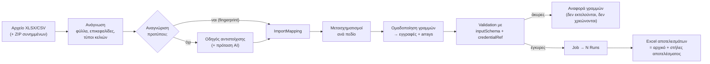

# 20 — Data mapping από Excel / CSV

**Στόχος:** ο χειριστής (ή η εφαρμογή του πελάτη μέσω API) δίνει **το δικό του** Excel, όπως το έχει ήδη, και το DG Complete το μετατρέπει σε έγκυρα inputs της μεθόδου: μία εκτέλεση ανά εγγραφή, με τους σωστούς κωδικούς δικαιούχου, τα σωστά συνημμένα και τις τιμές στη μορφή που θέλει το τρίτο σύστημα. Η αντιστοίχιση ορίζεται **μία φορά** ως πρότυπο και ξαναχρησιμοποιείται.

Αντικαθιστά τον απλό ColumnMapper του P11 (που μένει ως «γρήγορη αντιστοίχιση» χωρίς πρότυπο).

---

## 1. Ροή



## 2. Πρότυπο αντιστοίχισης (`ImportMapping`)

- Ανήκει σε **μέθοδο** και σε **μορφή αρχείου** (π.χ. «Excel παραστατικών WWA», «Εξαγωγή SoftOne πελατών»). Μία μέθοδος μπορεί να έχει πολλά πρότυπα.
- **Fingerprint:** κανονικοποιημένες επικεφαλίδες (lowercase, χωρίς τόνους/κενά) + όνομα φύλλου. Όταν ανεβαίνει αρχείο, προτείνεται αυτόματα το πρότυπο με το καλύτερο ταίριασμα (≥ 90% των απαιτούμενων στηλών).
- Έχει **έκδοση** και δένεται σε `inputSchema` hash. Όταν αλλάξει η έκδοση της μεθόδου, ελέγχεται η συμβατότητα (§8).
- Χρήση από το API: `POST …/methods/{m}/jobs` με `multipart/form-data` (`file`, `mappingId`, προαιρετικά `attachments.zip`) ή με `fileId` από το `POST /files` (docs/21).

```jsonc
// ImportMapping.definition
{
  "source": {
    "sheet": "Παραστατικά",            // ή { "index": 0 }
    "headerRow": "auto",               // ή αριθμός γραμμής· auto = πρώτη γραμμή με ≥ 60% κείμενα
    "skipRows": [], "skipEmpty": true,
    "joins": [                         // δεύτερο φύλλο που ενώνεται με κλειδί
      { "sheet": "Δικαιούχοι", "on": { "left": "ΑΦΜ", "right": "ΑΦΜ" }, "prefix": "ben." }
    ]
  },
  "groupBy": ["ΑΦΜ", "Αρ. αιτήματος"],  // πολλές γραμμές → μία εγγραφή (κενό = 1 γραμμή = 1 εγγραφή)
  "credentialRef": { "column": "ΑΦΜ", "format": "afm:{{value | digits | pad 9}}" },
  "fields": {
    "afm":    { "column": "ΑΦΜ", "transform": "digits | pad 9" },
    "iban":   { "column": "IBAN", "transform": "upper | nospaces" },
    "amount": { "expr": "sum(rows, 'Ποσό')" },                         // συνάθροιση στην ομάδα
    "region": { "column": "Περιφέρεια", "valueMap": "opske-regions" },  // πίνακας τιμών
    "date":   { "column": "Ημ/νία", "transform": "date 'dd/MM/yyyy'" },
    "note":   { "const": "Υποβολή μέσω DG Complete" },
    "invoices": {                                                       // array από τις γραμμές της ομάδας
      "each": "rows",
      "fields": {
        "number": { "column": "Αρ. παραστατικού" },
        "amount": { "column": "Ποσό", "transform": "decimal ','" },
        "file":   { "column": "Αρχείο", "attachment": true }            // όνομα αρχείου στο ZIP ή URL
      }
    }
  },
  "defaults": { "region": "ΑΤΤΙΚΗ" }
}
```

## 3. Μετασχηματισμοί

Χρησιμοποιούν **την ίδια βιβλιοθήκη φίλτρων και εκφράσεων με το DSL** (`lib/dsl`, docs/05), ώστε να μη μάθει ο χρήστης δεύτερη γλώσσα:

| Κατηγορία | Παραδείγματα |
|---|---|
| Καθαρισμός | `trim`, `upper`, `lower`, `noaccents` (ΑΘΗΝΑ από Αθήνα), `nospaces`, `digits`, `pad 9` |
| Αριθμοί | `decimal ','` (1.234,56 → 1234.56), `round 2`, `percent` |
| Ημερομηνίες | serial ημερομηνίες Excel, `date 'dd/MM/yyyy'`, ζώνη Europe/Athens |
| Σύνθεση | `concat`, `split ' ' 0`, `regex`, `default`, `if` |
| Πίνακες τιμών | `valueMap: '<όνομα>'` — αποθηκευμένοι πίνακες ανά tenant (π.χ. περιφέρειες ΟΠΣΚΕ, ΔΟΥ, ΚΑΔ), με αλλαγές που καταγράφονται στο audit |
| Ομάδα | `sum`, `count`, `first`, `join` πάνω στις γραμμές της ομάδας (`rows`) |

Τα εξαρτώμενα πεδία (π.χ. Δήμος ανά Π.Ε.) ελέγχονται στην προεπισκόπηση με τον κατάλογο επιλογών (`OptionCatalog`, docs/25 §4), με πρόταση πλησιέστερης τιμής.

Ελληνικοί έλεγχοι (ΑΦΜ check digit, IBAN mod‑97, ΑΜΚΑ) διαθέσιμοι ως `validate: 'afm' | 'iban' | 'amka'` ανά πεδίο.

## 4. Οδηγός αντιστοίχισης (UI)

```
┌──────────────────────────────────────────────────────────────────────────────────────┐
│ Μαζική εργασία · ΟΠΣΚΕ · Αίτημα καταβολής     Αρχείο: παραστατικά_οκτ.xlsx  ▾ φύλλο │
├───────────────────────────────┬─────────────────────────────┬────────────────────────┤
│ ΣΤΗΛΕΣ ΑΡΧΕΙΟΥ (δείγμα)       │ ΠΕΔΙΑ ΜΕΘΟΔΟΥ               │ ΠΡΟΕΠΙΣΚΟΠΗΣΗ (εγγρ. 1)│
│ ΑΦΜ          094014201        │ afm *     ← ΑΦΜ   digits    │ afm: 094014201         │
│ Επωνυμία     ΑΛΦΑ ΕΕ          │ iban *    ← IBAN  upper     │ iban: GR16…            │
│ IBAN         gr16 0110 …      │ amount *  = sum(Ποσό)       │ amount: 1.240,00       │
│ Αρ. αιτήμ.   Α-104            │ region    ← Περιφέρεια ▸ map│ region: 01             │
│ Αρ. παρ/κού  ΤΠΥ 233          │ invoices[]  ανά γραμμή      │ invoices: 3            │
│ Ποσό         620,00           │   number  ← Αρ. παρ/κού     │  ΤΠΥ 233 · 620,00 · 📎 │
│ Αρχείο       tpy233.pdf       │   file    ← Αρχείο  📎 ZIP  │                        │
│ Περιφέρεια   Αττική           │ Ομαδοποίηση: ΑΦΜ + Αρ. αιτ. │ ✔ 118 έγκυρες          │
│                               │ Κωδικοί: afm:{{ΑΦΜ}}        │ ✖ 4 με σφάλμα  [λίστα] │
├───────────────────────────────┴─────────────────────────────┴────────────────────────┤
│ [Πρόταση AI]  [Αποθήκευση ως πρότυπο «Παραστατικά WWA»]      122 εγγραφές = 122 εκτελ.│
└──────────────────────────────────────────────────────────────────────────────────────┘
```

- Drag από στήλη σε πεδίο ή επιλογή από λίστα· auto‑match από labels του inputSchema, aliases του προτύπου και ιστορικό.
- Η προεπισκόπηση δείχνει την **τελική** εγγραφή (μετά τους μετασχηματισμούς), όχι την ακατέργαστη γραμμή, και επιτρέπει μετακίνηση ανάμεσα σε εγγραφές.
- Τα σφάλματα φαίνονται ανά γραμμή του αρχείου (π.χ. «Γραμμή 17: μη έγκυρο IBAN», «Γραμμή 22: δεν υπάρχουν κωδικοί για ΑΦΜ 0xxx»).
- Ο αριθμός εκτελέσεων που θα χρεωθούν μόνο αν πετύχουν φαίνεται πριν την εκκίνηση (docs/14).

## 5. Ανάγνωση «δύσκολων» αρχείων

- XLSX, XLS (μέσω μετατροπής), CSV με ανίχνευση encoding (UTF‑8 / Windows‑1253) και διαχωριστικού (`;` `,` tab).
- Επιλογή φύλλου, αυτόματη ή ρητή γραμμή επικεφαλίδων, παράλειψη γραμμών τίτλου/συνόλων.
- Συγχωνευμένα κελιά: η τιμή αντιγράφεται σε όλα τα κελιά της περιοχής. Κελιά με τύπους: διαβάζεται η υπολογισμένη τιμή. Κρυφές στήλες/γραμμές: προαιρετικά αγνοούνται.
- Όρια: 20 MB αρχείο, 10.000 εγγραφές μετά την ομαδοποίηση (όριο job, docs/13 #18), ZIP συνημμένων έως 500 MB / 2.000 αρχεία.
- Η ανάλυση γίνεται στον worker (queue `imports`), ποτέ στο web.

## 6. Κωδικοί δικαιούχου και συνημμένα

- **`credentialRef`** από στήλη (συνήθως ΑΦΜ). Πριν τη δημιουργία του job ελέγχεται ότι υπάρχει σετ κωδικών για κάθε ΑΦΜ (docs/18 §2) και ότι η εξουσιοδότηση δεν έχει λήξει. Οι εγγραφές χωρίς κωδικούς πάνε στην αναφορά σφαλμάτων.
- **Συνημμένα:** στήλη με όνομα αρχείου → αναζήτηση στο ZIP που ανέβηκε μαζί (case‑insensitive, χωρίς φακέλους), ή URL (https, docs/21 §3). Κάθε αρχείο γίνεται `FileObject` (docs/21) και στο input μπαίνει το `fileId`. Αρχείο που λείπει = σφάλμα γραμμής.

## 7. Πρόταση αντιστοίχισης με AI

`suggestMapping` (νέα εργασία στο docs/16): στέλνει στο OpenRouter τις επικεφαλίδες, έως 5 δείγματα τιμών ανά στήλη **με redaction** (ΑΦΜ/IBAN/ονόματα αντικαθίστανται από τύπο, π.χ. `<AFM>`) και το inputSchema. Επιστρέφει προτεινόμενα `fields`, `groupBy`, `credentialRef` και μετασχηματισμούς σε zod schema. Ο χρήστης βλέπει τις προτάσεις σημειωμένες και τις αποδέχεται μία‑μία ή όλες. Χρέωση AI κατά docs/14 §7.

## 8. Συμβατότητα με νέες εκδόσεις μεθόδου

Όταν μια μέθοδος γίνει pin σε νέα έκδοση, κάθε πρότυπο ελέγχεται απέναντι στο νέο `inputSchema`:

| Αλλαγή | Συμπεριφορά |
|---|---|
| Νέο προαιρετικό πεδίο | Το πρότυπο μένει ενεργό, ειδοποίηση «νέο πεδίο διαθέσιμο» |
| Νέο υποχρεωτικό πεδίο | Το πρότυπο γίνεται `NEEDS_UPDATE`· δεν χρησιμοποιείται μέχρι να οριστεί αντιστοίχιση ή `default` |
| Αφαίρεση/μετονομασία πεδίου | `NEEDS_UPDATE` με πρόταση (ίδιο label → νέο key) |
| Αλλαγή τύπου | Έλεγχος με τα δείγματα του τελευταίου αρχείου· αν αποτυγχάνει → `NEEDS_UPDATE` |

## 9. Αποτελέσματα

Το «Εξαγωγή XLSX» του job επιστρέφει **το αρχικό αρχείο** (ίδια φύλλα, ίδια σειρά, ίδια μορφοποίηση) με νέες στήλες στο τέλος: `Κατάσταση`, `Αποτέλεσμα` (π.χ. αριθμός αιτήματος από `output`), `Σφάλμα`, `Κωδικός σφάλματος`, `Run`, `Στιγμιότυπο` (σύνδεσμος στη σελίδα εκτέλεσης — όχι δημόσιο URL). Σε ομαδοποιημένες εγγραφές το αποτέλεσμα γράφεται σε όλες τις γραμμές της ομάδας. Υπάρχει και μορφή «μόνο αποτυχίες», ώστε να διορθωθούν και να ξανανέβουν.

## 10. Δεδομένα

```prisma
model ImportMapping {
  id           String   @id @default(cuid())
  tenantId     String
  methodId     String
  name         String
  fingerprint  String   // hash κανονικοποιημένων επικεφαλίδων + φύλλου
  definition   Json     // §2
  schemaHash   String   // inputSchema με το οποίο ελέγχθηκε
  status       String   @default("ACTIVE") // ACTIVE | NEEDS_UPDATE | ARCHIVED
  version      Int      @default(1)
  createdById  String
  updatedAt    DateTime @updatedAt
  createdAt    DateTime @default(now())
  @@unique([methodId, name])
  @@index([tenantId, fingerprint])
}

model ValueMap {           // πίνακες τιμών ανά tenant (π.χ. «opske-regions»)
  id        String   @id @default(cuid())
  tenantId  String
  name      String
  entries   Json     // [{ from: "Αττική", to: "01" }, …] — σύγκριση με noaccents/lower
  fallback  String?  // "error" | "keep" | σταθερή τιμή
  updatedAt DateTime @updatedAt
  @@unique([tenantId, name])
}
```

Το `Job` αποκτά `mappingId` και `mappingVersion`, ώστε να φαίνεται με ποιο πρότυπο έγινε κάθε μαζική εργασία.
