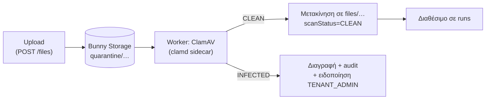

# 21 — Αρχεία μέσω API (συνημμένα για upload βήματα)

**Πρόβλημα:** οι ροές του ΟΠΣΚΕ (και πολλών άλλων συστημάτων) ανεβάζουν παραστατικά και δικαιολογητικά (βήμα `upload`, docs/05). Η εφαρμογή του πελάτη χρειάζεται έναν ασφαλή, απλό τρόπο να στέλνει αυτά τα αρχεία μαζί με τα δεδομένα.

**Λύση:** τα αρχεία γίνονται πρώτα **`FileObject`** (αποθηκευμένα στο Bunny Storage, ιδιωτικά), και το input της μεθόδου αναφέρεται σε αυτά με `fileId`. Ο worker τα κατεβάζει τη στιγμή του `upload` και τα δίνει στον browser.

---

## 1. Τρεις τρόποι αποστολής

| Τρόπος | Πότε | Πώς |
|---|---|---|
| **A. Προ‑ανέβασμα** (συνιστάται) | Αρχεία > 1 MB, batch, επανάληψη | `POST /files` (multipart) → `{ fileId }` → `fileId` στο input |
| **B. Inline** | Μικρά αρχεία, μία εκτέλεση | `POST …/runs` με `multipart/form-data`: μέρος `input` (JSON) + μέρη αρχείων· στο input `"file": { "part": "invoice1" }` |
| **C. URL** | Το αρχείο υπάρχει ήδη σε server του πελάτη | `"file": { "url": "https://…", "headers": { "Authorization": "…" } }` — το DG Complete το κατεβάζει **πριν** την ουρά και το κάνει FileObject |

Και στις τρεις περιπτώσεις, όταν το run μπει στην ουρά, το input περιέχει μόνο `fileId`: η εκτέλεση δεν εξαρτάται από εξωτερικό URL ή από το αίτημα.

## 2. Endpoints

| Method | Path | Scope | Περιγραφή |
|---|---|---|---|
| POST | `/files` | files:write | Multipart upload (`file`, προαιρετικά `name`, `purpose`, `externalRef`). Απάντηση `201 { fileId, name, size, contentType, sha256, expiresAt, scanStatus }` |
| POST | `/files/from-url` | files:write | `{ url, headers?, name? }` → ίδια απάντηση (λήψη από τον server μας) |
| POST | `/files/uploads` | files:write | Για αρχεία > 25 MB: δημιουργεί upload session και επιστρέφει signed PUT URL προς Bunny Storage (απευθείας, χωρίς να περνά από το web) + `POST /files/uploads/{id}/complete` |
| GET | `/files/{id}` | files:read | Μεταδεδομένα + κατάσταση ελέγχου |
| DELETE | `/files/{id}` | files:write | Διαγραφή (αν δεν χρησιμοποιείται από run σε εξέλιξη) |

Το `Idempotency-Key` ισχύει και εδώ (ίδιο key + ίδιο sha256 → ίδιο `fileId`).

```bash
# A. προ-ανέβασμα και εκτέλεση
curl -X POST https://complete.dgsmart.gr/api/v1/files \
  -H "Authorization: Bearer dgc_…" -F "file=@tpy233.pdf" -F "purpose=invoice"
# → { "fileId": "fil_9x2…", "scanStatus": "PENDING", "expiresAt": "2026-11-01T…" }

curl -X POST https://complete.dgsmart.gr/api/v1/collections/opske/methods/aitima-katavolis/runs \
  -H "Authorization: Bearer dgc_…" -H "Content-Type: application/json" \
  -d '{ "credentialRef": "afm:094014201",
        "input": { "iban": "GR16…", "invoices": [ { "number": "ΤΠΥ 233", "amount": 620, "file": { "fileId": "fil_9x2…" } } ] } }'
```

## 3. Πεδίο τύπου `file` στο input schema

Το DSL ήδη ορίζει τύπο `file` (docs/05 §2). Συμπληρώνεται με περιορισμούς ανά πεδίο, που εμφανίζονται και στο OpenAPI και στο Postman (docs/17):

```jsonc
"file": {
  "type": "file",
  "accept": ["application/pdf", "image/jpeg", "image/png"],   // MIME με έλεγχο magic bytes, όχι μόνο κατάληξη
  "maxSizeMb": 10,
  "required": true
}
```

- OpenAPI: `{ "type": "object", "properties": { "fileId": { "type": "string" } }, "x-dgc-file": { accept, maxSizeMb } }`, καθώς και `oneOf` για `part` / `url`.
- Validation πριν την ουρά: το `fileId` υπάρχει, ανήκει στον ίδιο tenant, `scanStatus = CLEAN`, τύπος και μέγεθος εντός ορίων. Αλλιώς `422 E_FILE_INVALID` με λεπτομέρεια, και η κλήση δεν χρεώνεται.
- Στο βήμα `upload` ο worker κατεβάζει το αρχείο από το Bunny σε προσωρινό φάκελο του browser context, κάνει `setInputFiles` και το σβήνει μόλις τελειώσει το βήμα. Το αρχικό όνομα αρχείου διατηρείται, γιατί πολλά κρατικά συστήματα το εμφανίζουν.

## 4. Όρια

| Όριο | Default | Ρύθμιση |
|---|---|---|
| Μέγιστο αρχείο (direct `POST /files`) | 25 MB | ανά πακέτο |
| Μέγιστο αρχείο (upload session) | 200 MB | ανά πακέτο |
| Αρχεία ανά run | 50 | — |
| Επιτρεπτοί τύποι (αν το πεδίο δεν ορίζει) | PDF, JPEG, PNG, TIFF, DOCX, XLSX, ZIP (μόνο για import, docs/20) | allowlist ανά tenant |
| Αποθήκευση ανά tenant | κατά πακέτο (π.χ. 5 / 50 / 250 GB) | Plan |
| Rate limit uploads | 120 / λεπτό ανά API key | Valkey |

Εκτελέσιμα, scripts και αρχεία με macros (`.exe`, `.js`, `.docm`, `.xlsm` κ.λπ.) απορρίπτονται πάντα.

## 5. Έλεγχος για ιούς



- **ClamAV** ως sidecar container του worker (`clamd`, ενημέρωση υπογραφών από `freshclam` κάθε 2 ώρες). Ο έλεγχος γίνεται στον worker (queue `files`), όχι στο web.
- Έλεγχος magic bytes απέναντι στο δηλωμένο `contentType`. Τα PDF με JavaScript ή embedded αρχεία σημειώνονται ως `SUSPICIOUS` (ρυθμιζόμενο: απόρριψη ή αποδοχή).
- Ένα run που αναφέρεται σε αρχείο `PENDING` περιμένει στην ουρά μέχρι 5′ για τον έλεγχο. Αν το αρχείο βρεθεί `INFECTED`, το run γίνεται `FAILED` με `E_FILE_INFECTED` και δεν χρεώνεται.

## 6. Διάρκεια ζωής και διαγραφή

- **Χωρίς χρήση:** ένα FileObject που δεν χρησιμοποιήθηκε σβήνεται μετά από **7 ημέρες** (`expiresAt`).
- **Μετά την εκτέλεση:** το αρχείο σβήνεται **24 ώρες μετά την επιτυχή ολοκλήρωση** του τελευταίου run που το χρησιμοποιεί (περιθώριο για χειροκίνητη επανάληψη). Σε αποτυχία κρατιέται όσο το `artifactRetentionDays` του πακέτου, ώστε να είναι δυνατή η επανάληψη.
- Ρύθμιση tenant `files.keepAfterSuccess` (π.χ. 30 ημέρες) για πελάτες που θέλουν απόδειξη του τι ανέβηκε. Το sha256 και το όνομα μένουν πάντα στο `RunStep` ως τεκμήριο, ακόμα κι όταν σβηστεί το αρχείο.
- Η διαγραφή γίνεται από την εργασία `retention.files` (στο `lib/jobs/registry.ts`, docs/10 §4β), με batch διαγραφή στο Bunny.

## 7. Ασφάλεια

- Ιδιωτικό path `/{tenantId}/files/{fileId}` στο Bunny Storage (ίδια zone με τα artifacts, docs/08). Ποτέ δημόσιο URL. Λήψη από το UI μόνο μέσω `/api/artifacts`-τύπου route με έλεγχο δικαιώματος και signed URL 15′.
- Λήψη από URL (§1 C): μόνο `https`, απαγόρευση ιδιωτικών IP και `localhost` (προστασία SSRF), timeout 60s, όριο μεγέθους, χωρίς ακολουθία redirect σε άλλο host.
- RLS στο `FileObject` όπως στα υπόλοιπα μοντέλα tenant.
- Στα logs και στα στιγμιότυπα δεν εμφανίζεται το περιεχόμενο του αρχείου, μόνο όνομα, μέγεθος και sha256.

## 8. Δεδομένα

```prisma
model FileObject {
  id           String    @id @default(cuid())
  tenantId     String
  name         String
  contentType  String
  size         Int
  sha256       String
  storagePath  String
  purpose      String?
  externalRef  String?
  source       String    // API | API_URL | INLINE | IMPORT_ZIP | UI
  scanStatus   String    @default("PENDING") // PENDING | CLEAN | INFECTED | SUSPICIOUS | ERROR
  scannedAt    DateTime?
  apiKeyId     String?
  uploadedById String?
  expiresAt    DateTime?
  lastUsedAt   DateTime?
  deletedAt    DateTime?
  createdAt    DateTime  @default(now())
  @@index([tenantId, createdAt])
  @@index([expiresAt])
}
```

Πίνακας `RunFile (runId, fileId, stepId)` καταγράφει ποια αρχεία χρησιμοποίησε κάθε run, για τη διαγραφή μετά την εκτέλεση και για το audit.
