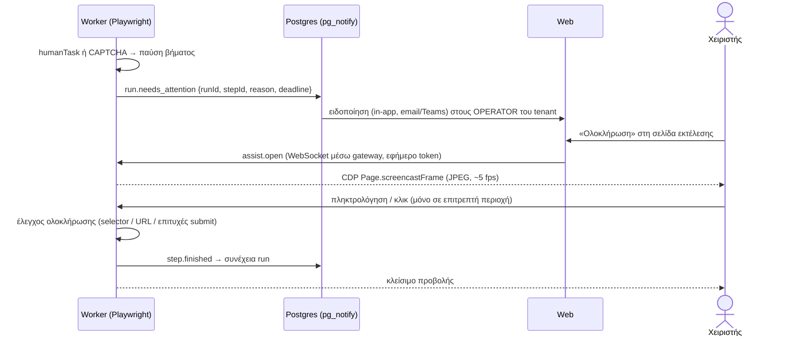

# 22 — Ζωντανή προβολή για OTP / CAPTCHA (live assist)

**Πρόβλημα:** όταν μια εκτέλεση φτάσει σε `humanTask` (π.χ. κλειδάριθμος/OTP του TaxisNet) ή ανιχνευτεί CAPTCHA (`E_CAPTCHA_DETECTED`, docs/06), το run γίνεται `NEEDS_ATTENTION`. Ο χειριστής όμως δεν βλέπει τον browser του worker, άρα δεν μπορεί να ολοκληρώσει την ενέργεια.

**Λύση:** η σελίδα της εκτέλεσης ανοίγει **ζωντανή προβολή** του browser του worker (CDP screencast), ώστε ο χειριστής να δει την οθόνη και να πληκτρολογήσει ή να κάνει κλικ **μόνο** στην περιοχή που χρειάζεται. Μετά η εκτέλεση συνεχίζει αυτόματα. Είναι η ίδια τεχνολογία με την καταγραφή χωρίς extension της φάσης 3 (P17), αλλά νωρίτερα και περιορισμένη σε αυτή τη χρήση.

---

## 1. Ροή



## 2. Τι βλέπει και τι μπορεί να κάνει ο χειριστής

- Panel μέσα στη σελίδα της εκτέλεσης (και στον καμβά, docs/19 §4, πάνω στον κόμβο): εικόνα του browser, οδηγίες του `humanTask` (π.χ. «Πληκτρολογήστε τον κλειδάριθμο που ήρθε με SMS στο κινητό του δικαιούχου»), αντίστροφη μέτρηση μέχρι το timeout και κουμπιά «Ολοκληρώθηκε» / «Αδυναμία — ακύρωση run».
- **Περιορισμένη αλληλεπίδραση:**
  - **`focus` mode (default):** η εικόνα δείχνει όλη τη σελίδα, αλλά τα κλικ και η πληκτρολόγηση επιτρέπονται **μόνο** μέσα στα στοιχεία που ορίζει το βήμα (`humanTask.allow: [Locator]`, π.χ. το πεδίο OTP και το κουμπί «Συνέχεια»). Ό,τι είναι εκτός περιοχής εμφανίζεται θολό.
  - **`full` mode:** πλήρης έλεγχος της σελίδας (π.χ. CAPTCHA με εικόνες). Το ενεργοποιεί μόνο χρήστης με δικαίωμα `tenant.runs.assist.full` και καταγράφεται.
- Δεν επιτρέπεται πλοήγηση σε άλλο URL, άνοιγμα νέων tabs, downloads ή copy/paste από τον browser του worker προς τον χειριστή. Paste από τον χειριστή προς το πεδίο επιτρέπεται (π.χ. OTP από email).
- **Απλή φόρμα αντί για εικόνα:** όταν το `humanTask` ορίζει `fields` (π.χ. `otp: string`), ο χειριστής μπορεί απλώς να γράψει την τιμή σε φόρμα της εφαρμογής, και ο worker τη συμπληρώνει μόνος του. Η εικόνα μένει διαθέσιμη για επιβεβαίωση.

## 3. Ειδοποιήσεις και χρόνοι

| Στοιχείο | Default | Ρύθμιση |
|---|---|---|
| Ποιος ειδοποιείται | Ο χρήστης που ξεκίνησε το run (UI/job), αλλιώς όλοι οι `TENANT_OPERATOR` | ανά μέθοδο: λίστα χρηστών/ομάδα |
| Κανάλια | in‑app (άμεσα, με ήχο αν η καρτέλα είναι ανοιχτή) + email· Teams webhook αν έχει οριστεί | ανά tenant |
| Timeout | 15′ (`humanTask.timeoutSec`, docs/05) | ανά βήμα |
| Υπενθύμιση | στο 50% του χρόνου | — |
| Λήξη | `E_HUMAN_TIMEOUT`, το run γίνεται FAILED (δεν χρεώνεται, docs/14) και ειδοποιείται ο υπεύθυνος | — |

- Όσο ένα run περιμένει άνθρωπο, **ο browser context μένει ανοιχτός** αλλά δεν δεσμεύει slot εκτέλεσης του tenant (μετράει σε χωριστό όριο `maxWaitingRuns`, default 5), ώστε τα υπόλοιπα runs να προχωρούν.
- Σε μαζικές εργασίες, τα runs που χρειάζονται OTP συγκεντρώνονται σε λίστα «Αναμένουν ενέργεια» στη σελίδα του job, με μία‑μία ολοκλήρωση.

## 4. Τεχνικά

- **Πηγή εικόνας:** CDP `Page.startScreencast` (JPEG, quality 60, max 1280px, έως 5 fps) από τον worker. Μόνο για runs σε `NEEDS_ATTENTION` και μόνο όσο είναι ανοιχτό το panel.
- **Μεταφορά:** WebSocket από τον browser του χειριστή προς ένα **assist gateway** στο web (`/api/assist/[runId]`), το οποίο ανοίγει εσωτερικό WebSocket (`WORKER_ASSIST_URL`, κοινό secret) προς τον worker που κρατά το session, μόνο στο ιδιωτικό δίκτυο (ADR‑022). Ο worker δεν εκτίθεται ποτέ απευθείας στο internet.
- **Είσοδος:** τα γεγονότα ποντικιού/πληκτρολογίου μετατρέπονται σε `Input.dispatchMouseEvent` / `Input.insertText` στον worker, **αφού** ελεγχθεί ότι οι συντεταγμένες πέφτουν μέσα σε επιτρεπτό στοιχείο (bounding box των `allow` locators, ξαναϋπολογισμένο σε κάθε frame).
- **Token:** εφήμερο (2′, ένα run, ένας χρήστης), υπογεγραμμένο, που ανανεώνεται όσο το panel είναι ανοιχτό. Μόνο ένας χειριστής κάθε φορά σε κάθε run (lock με `expiresAt` στη βάση).
- **Έλεγχος ολοκλήρωσης:** το `humanTask` ορίζει `completeWhen` (εμφάνιση/εξαφάνιση selector, αλλαγή URL ή ρητό «Ολοκληρώθηκε» του χειριστή). Μετά την ολοκλήρωση γίνεται κανονικά `checkTargetErrors`.
- **Coolify/Traefik:** WebSocket upgrade στο route `/api/assist/*` (docs/10).

## 5. Ασφάλεια και καταγραφή

- Δικαιώματα: `tenant.runs.assist` (OPERATOR, ADMIN), `tenant.runs.assist.full` (μόνο ADMIN). Το προσωπικό της DGsoft **δεν** έχει πρόσβαση στη ζωντανή προβολή εκτός αν ο tenant το επιτρέψει ρητά για συγκεκριμένο run.
- Audit: `assist.open`, `assist.input` (χωρίς τις τιμές — μόνο ότι έγινε πληκτρολόγηση σε ποιο στοιχείο), `assist.complete`, `assist.timeout`.
- Τα frames **δεν αποθηκεύονται**. Κρατιέται μόνο ένα στιγμιότυπο πριν και ένα μετά την ενέργεια (masked, docs/08), ως τεκμήριο.
- Οι τιμές που πληκτρολογεί ο χειριστής (OTP) δεν γράφονται σε logs ούτε σε RunStep.

## 6. Αλλαγές στο DSL

```jsonc
{ "id": "s03", "type": "humanTask", "label": "Κλειδάριθμος TaxisNet",
  "instructions": "Πληκτρολογήστε τον κλειδάριθμο που έλαβε ο δικαιούχος με SMS.",
  "fields": [ { "key": "otp", "label": "Κλειδάριθμος", "type": "string", "fill": { "candidates": [ { "kind": "label", "value": "Κλειδάριθμος" } ] } } ],
  "allow": [ { "candidates": [ { "kind": "label", "value": "Κλειδάριθμος" } ] }, { "candidates": [ { "kind": "role", "role": "button", "name": "Συνέχεια" } ] } ],
  "mode": "focus",
  "completeWhen": { "urlMatches": "**/dashboard**" },
  "timeoutSec": 900 }
```

Ένα βήμα με `detectCaptcha: true` (default σε login flows) μετατρέπεται αυτόματα σε `humanTask` με `mode: "full"` όταν ανιχνευτεί CAPTCHA.
