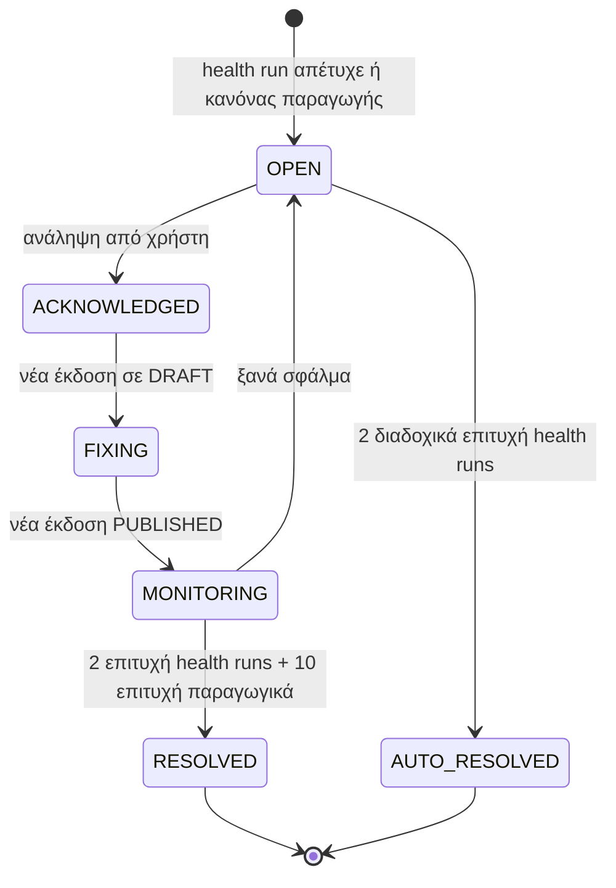
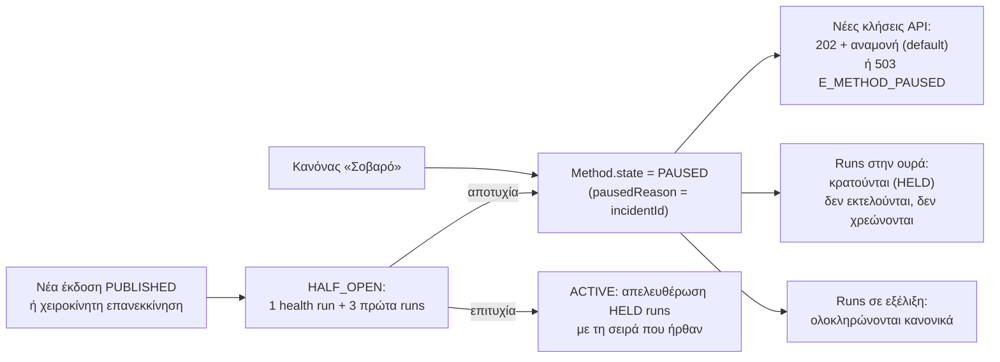

# 23 — Αναγνώριση αλλαγών στα τρίτα συστήματα και αυτόματη παύση μεθόδων

**Πρόβλημα:** τα κρατικά συστήματα (TAXIS, ΟΠΣΚΕ) αλλάζουν οθόνες χωρίς προειδοποίηση. Χρειαζόμαστε να **μαθαίνουμε πρώτοι** ότι κάτι έσπασε, να ειδοποιείται **ο σωστός άνθρωπος μέσα σε λίγα λεπτά**, και να **μην καίγονται** εκατοντάδες εκτελέσεις στην ουρά με το ίδιο σφάλμα μέχρι να διορθωθεί η ροή.

---

## 1. Τρεις πηγές σήματος

| Πηγή | Πότε | Τι ανιχνεύει |
|---|---|---|
| **Health run** (συνθετικό) | Κάθε ώρα 07:00–22:00 και μία φορά τη νύχτα (εργασία `health.targets`, docs/10 §4β) | Εκτέλεση της ροής ελέγχου ανά σύστημα σε δοκιμαστικό δικαιούχο, **χωρίς** υποβολή (σταματά πριν το σημείο δέσμευσης) |
| **Παραγωγικά runs** | Συνεχώς | Ίδιος κωδικός σφάλματος στο ίδιο βήμα σε πολλά runs διαφορετικών εισόδων |
| **Οπτική/δομική απόκλιση** | Σε κάθε health run και σε δείγμα παραγωγικών | Αλλαγή του DOM ή της εικόνας ενός βήματος σε σχέση με baseline, ακόμα κι αν το βήμα πέτυχε |

### Health run
- Για κάθε TargetSystem ορίζεται μία **ροή ελέγχου** (`TargetSystem.healthWorkflowId`). Συνήθως είναι αντίγραφο των κύριων ροών μέχρι **πριν** το σημείο δέσμευσης: login, πλοήγηση, άνοιγμα φόρμας, ανάγνωση πεδίων.
- Τρέχει με τα `healthCredentialRef` (δοκιμαστικός δικαιούχος της WWA, docs/18 §3).
- Δεν χρεώνεται (`trigger = HEALTH`). Μετρά σε χωριστό όριο ταυτόχρονων εκτελέσεων, ώστε να μη στερεί πόρους από τα παραγωγικά runs.

### Απόκλιση (drift) χωρίς αποτυχία
- **Baseline ανά βήμα:** από την τελευταία επιτυχημένη εκτέλεση της δημοσιευμένης έκδοσης κρατιούνται `domSignature` (hash της απλοποιημένης δομής γύρω από το στοιχείο: tag, role, label, θέση στη φόρμα) και `STEP_THUMB` (docs/19).
- **Σύγκριση:** `domSignature` διαφορετική ή perceptual hash εικόνας με απόσταση > κατώφλι → `drift` στο βήμα. Επίσης `fallbackUsed`: αν βρέθηκε το στοιχείο μόνο με εναλλακτικό locator (docs/06), είναι ισχυρή ένδειξη ότι η οθόνη άλλαξε.
- Το drift **δεν** παύει μεθόδους. Ανοίγει incident επιπέδου «Προειδοποίηση», ώστε ο designer να ενημερώσει τη ροή πριν σπάσει.

## 2. Incidents

Κάθε πρόβλημα γίνεται **Incident** ανά (TargetSystem, βήμα ή ροή):



| Επίπεδο | Κανόνας ενεργοποίησης | Ενέργεια |
|---|---|---|
| **Προειδοποίηση** | drift ή `fallbackUsed` σε ≥ 3 runs μέσα σε 1 ώρα | Ειδοποίηση στον designer της ροής. Καμία παύση. |
| **Σοβαρό** | 1 αποτυχημένο health run στο ίδιο βήμα (μετά από αυτόματο retry) **ή** ≥ 5 παραγωγικά runs με τον ίδιο `errorCode` στο ίδιο βήμα σε 15′ **ή** ποσοστό αποτυχίας μεθόδου > 30% σε ≥ 10 runs μέσα σε 15′ | Ειδοποίηση και **αυτόματη παύση** της μεθόδου (§4) |
| **Κρίσιμο** | Αποτυχία login σε όλα τα credentials ενός συστήματος ή το σύστημα δεν απαντά (`E_TARGET_UNAVAILABLE`) | Παύση **όλων** των μεθόδων του συστήματος + ειδοποίηση και στο προσωπικό της DGsoft |

Μόνο σφάλματα που δείχνουν αλλαγή του συστήματος μετρούν στους κανόνες: `E_LOCATOR_NOT_FOUND`, `E_ASSERTION_FAILED`, `E_NAVIGATION`, `E_TARGET_UNAVAILABLE`, `E_TIMEOUT`, `E_OPTIONS_TIMEOUT`, `E_OPTIONS_EMPTY`, `E_DEPENDENT_RESET` στο ίδιο βήμα (`E_OPTION_NOT_FOUND` είναι σφάλμα δεδομένων). Τα σφάλματα δεδομένων (`E_TARGET_VALIDATION`, π.χ. «ο ΑΦΜ υπάρχει ήδη») **δεν** ανοίγουν incident.

## 3. Ποιος ειδοποιείται και πόσο γρήγορα

| Επίπεδο | Πρώτος παραλήπτης | Κανάλι | Στόχος χρόνου ειδοποίησης | Κλιμάκωση |
|---|---|---|---|---|
| Προειδοποίηση | Designer/owner της ροής | in‑app + email (σύνοψη μία φορά την ημέρα) | ίδια ημέρα | — |
| Σοβαρό | Owner της ροής + TENANT_ADMIN | in‑app + email + Teams webhook (αν έχει οριστεί) | **≤ 5′** από τον κανόνα | Χωρίς ανάληψη σε 30′ → όλοι οι TENANT_ADMIN, και αν ο tenant έχει υπηρεσία υποστήριξης, το προσωπικό της DGsoft |
| Κρίσιμο | TENANT_ADMIN + platform on‑call της DGsoft | ό,τι παραπάνω + email στη λίστα on‑call | **≤ 5′** | Χωρίς ανάληψη σε 15′ → δεύτερος on‑call |

- **Owner ροής:** νέο πεδίο `Workflow.ownerId` (default ο δημιουργός). Υπάρχει και `TargetSystem.ownerIds` για σφάλματα σε επίπεδο συστήματος.
- Οι ειδοποιήσεις έχουν ενέργειες: «Ανάληψη», «Άνοιγμα ροής στον καμβά» (με κόκκινο το βήμα, docs/19), «Σύγκριση στιγμιότυπων» (baseline / τώρα), «Συνέχεια παρά το σφάλμα».
- **Dedup:** ένα incident = μία ειδοποίηση ανά κανάλι. Οι επόμενες αποτυχίες απλώς αυξάνουν τον μετρητή του incident.
- Ο έλεγχος κανόνων γίνεται από την εργασία `incidents.evaluate` κάθε λεπτό (lib/jobs/registry.ts) και άμεσα από τον worker, όταν τελειώνει ένα run με σχετικό σφάλμα.

## 4. Αυτόματη παύση μεθόδου (circuit breaker)



- **Runs που περιμένουν:** μένουν στη βάση με κατάσταση `HELD` (νέα κατάσταση run) και αφαιρούνται από την ουρά BullMQ. Δεν χάνονται, δεν χρεώνονται, και το `GET /runs/{id}` δείχνει `status: HELD, reason: "method_paused", incidentId`.
- **Νέες κλήσεις:** ρυθμίζεται ανά μέθοδο (`pausePolicy`):
  - **`QUEUE`** (default): δέχονται και γίνονται `HELD` (202 με `X-DGComplete-Method-State: paused`).
  - **`REJECT`**: `503 E_METHOD_PAUSED` με `Retry-After`, για εφαρμογές που προτιμούν να ξαναπροσπαθήσουν μόνες τους.
- **Μέγιστη αναμονή:** τα `HELD` runs λήγουν μετά από `heldMaxHours` (default 24h) → `CANCELLED` με `E_HELD_EXPIRED`, webhook `run.cancelled`, χωρίς χρέωση.
- **Webhooks:** `method.paused`, `method.resumed`, `incident.opened`, `incident.resolved`, ώστε η εφαρμογή του πελάτη να το δείξει στους χρήστες της.
- **Μαζικές εργασίες:** το job γίνεται `PAUSED`. Το UI δείχνει «Σε παύση λόγω αλλαγής στο ΟΠΣΚΕ — 340 εγγραφές περιμένουν» και ενεργοποιείται ξανά μαζί με τη μέθοδο.
- **Χειροκίνητα:** ο TENANT_ADMIN μπορεί να κάνει παύση ή επανεκκίνηση οποιαδήποτε στιγμή, ή να επιλέξει «Συνέχεια παρά το σφάλμα» για συγκεκριμένη μέθοδο (καταγράφεται στο audit).
- **HALF_OPEN:** μετά από διόρθωση εκτελείται πρώτα 1 health run και μετά απελευθερώνονται μόνο 3 runs. Μόνο αν πετύχουν απελευθερώνονται τα υπόλοιπα, με το rate limit του συστήματος (docs/18 §3).

## 5. Γρήγορη διόρθωση

Το incident ανοίγει κατευθείαν τη ροή στον **καμβά** (docs/19) με:
- το βήμα που αποτυγχάνει σημειωμένο, με baseline και τρέχον στιγμιότυπο δίπλα‑δίπλα (slider σύγκρισης) και το DOM diff του στοιχείου;
- πρόταση νέου locator από το AI (`suggestLocator`, docs/16), που εφαρμόζεται σε νέο DRAFT;
- «Δοκιμαστική εκτέλεση» με τον δοκιμαστικό δικαιούχο και, αν πετύχει, έγκριση/δημοσίευση (docs/02 — η υποχρεωτική έγκριση ισχύει και εδώ, με fast‑track: ειδοποίηση έγκρισης με προτεραιότητα).

Στόχος: **χρόνος από ειδοποίηση έως δημοσιευμένη διόρθωση < 2 ώρες** για αλλαγή ενός πεδίου.

## 6. Σελίδες

- `/t/[tenantId]/incidents`: ανοιχτά/κλειστά incidents, επίπεδο, σύστημα, μέθοδοι σε παύση, HELD runs, χρόνος ανάληψης/επίλυσης.
- `/t/[tenantId]/targets/[id]` → καρτέλα «Υγεία»: ιστορικό health runs (γραμμή ανά ώρα πράσινο/κόκκινο), drift ανά βήμα, owners.
- `/admin/incidents` (DGsoft): όλα τα κρίσιμα incidents όλων των tenants. Ιδιαίτερα χρήσιμο όταν πολλοί tenants χρησιμοποιούν το ίδιο κρατικό σύστημα, γιατί μια αλλαγή στο TAXIS τους επηρεάζει όλους.
- Στο dashboard του tenant: κάρτα «Κατάσταση συστημάτων» (TAXIS ✓, ΟΠΣΚΕ ⚠ παύση από 10:42).

## 7. Δεδομένα

```prisma
model Incident {
  id             String    @id @default(cuid())
  tenantId       String
  targetSystemId String
  workflowId     String?
  stepId         String?
  severity       String    // WARNING | SERIOUS | CRITICAL
  status         String    @default("OPEN") // OPEN | ACKNOWLEDGED | FIXING | MONITORING | RESOLVED | AUTO_RESOLVED
  rule           String    // health_failed | same_error_burst | failure_rate | login_all | drift | fallback
  errorCode      String?
  firstRunId     String?
  occurrences    Int       @default(1)
  ackById        String?
  ackAt          DateTime?
  resolvedAt     DateTime?
  openedAt       DateTime  @default(now())
  lastSeenAt     DateTime  @default(now())
  @@index([tenantId, status])
  @@index([targetSystemId, status])
}

model StepBaseline {      // baseline ανά βήμα δημοσιευμένης έκδοσης
  id           String   @id @default(cuid())
  tenantId     String
  versionId    String
  stepId       String
  domSignature String
  imageHash    String?
  thumbPath    String?
  runId        String
  updatedAt    DateTime @updatedAt
  @@unique([versionId, stepId])
}
```

Νέα πεδία:
- **`Method`:** `state` (`ACTIVE` | `PAUSED` | `HALF_OPEN`), `pausedAt`, `pausedReason`, `pausePolicy`, `heldMaxHours`.
- **`TargetSystem`:** `healthWorkflowId`, `healthCredentialRef`, `healthSchedule`, `ownerIds[]`.
- **`Workflow`:** `ownerId`.
- **`Run`:** κατάσταση `HELD`, `trigger = HEALTH`, `heldAt`.
