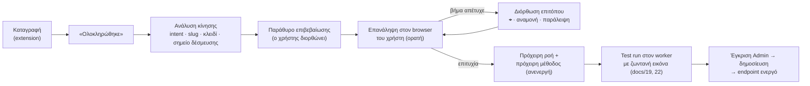

# 24 — Ολοκλήρωση καταγραφής, REST μέθοδος και επανάληψη μπροστά στον χρήστη

**Αρχή:** **κάθε καταγραφή = μία ολοκληρωμένη κίνηση του χρήστη** στο τρίτο σύστημα: μία καταχώριση, μία τροποποίηση, μία διαγραφή ή μία προβολή/ανάγνωση. Όταν τελειώσει, ο χρήστης πατά **«Ολοκληρώθηκε»**. Τότε η εφαρμογή:

1. αναγνωρίζει **τι είδους κίνηση** έγινε και προτείνει **όνομα και slug**;
2. φτιάχνει την αντίστοιχη **REST μέθοδο** (`POST` / `PUT` / `DELETE` / `GET`);
3. **ξαναπαίζει την κίνηση μπροστά στα μάτια του χρήστη**, βήμα‑βήμα, ώστε να δει ότι η εφαρμογή την κατάλαβε σωστά, πριν αποθηκευτεί ως πρόχειρο.



---

## 1. Κουμπί «Ολοκληρώθηκε»

- Αντικαθιστά το «Τέλος» στο side panel του extension (docs/04 §6). Είναι πάντα ορατό, στο ίδιο σημείο, ως primary κουμπί.
- Πριν κλείσει η καταγραφή, γίνονται έλεγχοι:
  - υπάρχει τουλάχιστον μία ενέργεια;
  - **η κίνηση φαίνεται ολοκληρωμένη:** μετά το τελευταίο submit εμφανίστηκε μήνυμα επιτυχίας ή άλλαξε η σελίδα, ή για προβολή υπάρχει `extract`. Αν όχι, ο χρήστης βλέπει «Δεν βλέπω επιβεβαίωση ότι η καταχώριση πέρασε — θέλετε να συνεχίσετε την καταγραφή ή να ορίσετε εσείς το μήνυμα επιτυχίας;» με κουμπί για να διαλέξει το μήνυμα στη σελίδα (γίνεται `assert`);
  - **μία κίνηση ανά καταγραφή:** αν ανιχνευτούν δύο submits σε διαφορετικές φόρμες (π.χ. νέος πελάτης και μετά νέο τιμολόγιο), προτείνεται χωρισμός σε δύο καταγραφές/μεθόδους, με σημείο κοπής που μπορεί να μετακινήσει ο χρήστης.
- Μετά το «Ολοκληρώθηκε», η καταγραφή γίνεται `FINISHED` και ανοίγει το παράθυρο επιβεβαίωσης (§4).

## 2. Αναγνώριση τύπου κίνησης (intent)

`lib/dsl/classify-recording.ts` (καθαρό TS + tests) βαθμολογεί σήματα από τα events της καταγραφής (docs/04 §3):

| Κίνηση | HTTP | Ισχυρά σήματα | Ασθενή σήματα |
|---|---|---|---|
| **Καταχώριση** (CREATE) | `POST` | click σε «Νέο / Νέα / Προσθήκη / Δημιουργία / Υποβολή αίτησης» πριν τη φόρμα· fills σε **κενά** πεδία· μετά το submit νέο αναγνωριστικό στη σελίδα ή στο URL | URL `/new`, `/create`, `/add` |
| **Τροποποίηση** (UPDATE) | `PUT` | η φόρμα άνοιξε **με προσυμπληρωμένες τιμές** (ο recorder κρατά `initialValue` κάθε πεδίου) και ο χρήστης άλλαξε κάποιες· πριν τη φόρμα αναζήτηση/άνοιγμα υπάρχουσας εγγραφής· κουμπί «Αποθήκευση αλλαγών / Ενημέρωση / Τροποποίηση» | URL με id (`/edit/123`, `?id=`) |
| **Διαγραφή** (DELETE) | `DELETE` | click σε «Διαγραφή / Αφαίρεση / Ακύρωση εγγραφής / Ανάκληση» + επιβεβαίωση σε dialog ή modal· λίγα ή καθόλου fills εκτός από την αναζήτηση | μήνυμα «διαγράφηκε» |
| **Προβολή** (READ) | `GET` | **κανένα** submit που αλλάζει δεδομένα· fills μόνο σε πεδία αναζήτησης/φίλτρων· η κίνηση τελειώνει με `extract`, πίνακα, λήψη αρχείου ή screenshot | σελίδες «Προβολή / Λεπτομέρειες / Εκτύπωση» |
| **Ενέργεια** (ACTION) | `POST …/{key}/{action}` | υποβολή που δεν δημιουργεί ούτε αλλάζει εγγραφή με την κλασική έννοια, π.χ. «Έκδοση βεβαίωσης», «Οριστική υποβολή», «Αποστολή» | — |

- Το αποτέλεσμα είναι πρόταση με **αιτιολόγηση** («Πατήθηκε "Διαγραφή" και επιβεβαιώθηκε το μήνυμα "Είστε σίγουροι;"») και βαθμό βεβαιότητας. Κάτω από 70% το παράθυρο ζητά ρητά από τον χρήστη να επιλέξει.
- Όπου χρειάζεται, το AI (`segmentFlow`, docs/16) βοηθά με τα κείμενα των κουμπιών και των μηνυμάτων, πάντα με redaction τιμών. Η τελική επιλογή είναι του χρήστη.
- Γλώσσα: λεξικά ελληνικών/αγγλικών όρων ανά intent, επεκτάσιμα ανά TargetSystem (π.χ. στο ΟΠΣΚΕ «Οριστικοποίηση» = ACTION).

## 3. Κλειδί εγγραφής, σημείο δέσμευσης και έξοδοι

- **Κλειδί** (UPDATE, DELETE, READ, ACTION): η τιμή με την οποία ο χρήστης **βρήκε** την εγγραφή, δηλαδή η τιμή στο πεδίο αναζήτησης (π.χ. ΑΦΜ, αριθμός αιτήματος) ή ένα τμήμα του URL. Γίνεται **path parameter** της μεθόδου (`{requestNo}`). Υποστηρίζεται και σύνθετο κλειδί (`{afm}/{year}`).
- **Σημείο δέσμευσης** (`commitPoint`, docs/06): το click που αποθηκεύει/διαγράφει. Μετά από αυτό δεν γίνεται αυτόματο retry. Προτείνεται αυτόματα: το τελευταίο submit πριν το μήνυμα επιτυχίας ή η επιβεβαίωση του dialog διαγραφής.
- **Έξοδοι:** για CREATE προτείνεται `extract` του νέου αναγνωριστικού (π.χ. «Αριθμός αιτήματος: Α‑2026‑1042») → `output.id`, που γίνεται και το `Location` της απάντησης. Για READ, κάθε `extract` → πεδίο εξόδου.
- **Εισόδοι:** όπως στο compile (docs/04 §5). Για UPDATE, τα πεδία που **δεν άλλαξε** ο χρήστης γίνονται προαιρετικά (`when: input.x != null`), ώστε η μέθοδος να δέχεται και μερική ενημέρωση (`PATCH` ως alias του `PUT`).

## 4. Παράθυρο επιβεβαίωσης

```
┌───────────────────────────────────────────────────────────────────┐
│ Ολοκληρώθηκε η καταγραφή · ΟΠΣΚΕ                                   │
│                                                                   │
│ Τι κάνατε;   ( ) Καταχώριση  (•) Τροποποίηση  ( ) Διαγραφή  ( ) Προβολή│
│              «Η φόρμα άνοιξε με τιμές και αλλάξατε 2 πεδία» · 92%   │
│                                                                   │
│ Όνομα        [ Τροποποίηση αιτήματος καταβολής              ]     │
│ Slug         [ aitima-katavolis ]   ✓ διαθέσιμο                   │
│ Κλειδί       [ requestNo ▾ ]  από το πεδίο «Αρ. αιτήματος»        │
│                                                                   │
│ Endpoint     PUT  /api/v1/opske/aitima-katavolis/{requestNo}      │
│ Είσοδοι      iban · amount (προαιρετικά: όσα δεν άλλαξαν)         │
│ Δέσμευση     βήμα 07 «Αποθήκευση αλλαγών»                         │
│                                                                   │
│ [Επανάληψη τώρα ▶]   [Αποθήκευση χωρίς επανάληψη]   [Συνέχεια καταγρ.]│
└───────────────────────────────────────────────────────────────────┘
```

### Πρόταση ονόματος και slug
- **Όνομα:** ρήμα της κίνησης + αντικείμενο. Το αντικείμενο προκύπτει από τον τίτλο της σελίδας της φόρμας, το heading, το breadcrumb ή το κείμενο του κουμπιού που την άνοιξε (π.χ. «Νέο αίτημα καταβολής» → «Καταχώριση αιτήματος καταβολής»).
- **Slug του πόρου:** μόνο το αντικείμενο, μεταγραμμένο με ELOT 743 (`Αίτημα καταβολής` → `aitima-katavolis`). Κανόνες: `[a-z0-9-]`, έως 48 χαρακτήρες, χωρίς stop‑words («του», «της», «νέο»).
- **Μία συλλογή ανά σύστημα** (TargetSystem slug, π.χ. `opske`), και **ένας πόρος, πολλές κινήσεις:** η καταχώριση, η τροποποίηση, η διαγραφή και η προβολή του ίδιου αντικειμένου μοιράζονται το ίδιο slug και διαφέρουν στο HTTP method. Αν υπάρχει ήδη πόρος με το ίδιο slug, η εφαρμογή ρωτά «Να προστεθεί ως ΤΡΟΠΟΠΟΙΗΣΗ στον υπάρχοντα πόρο "aitima-katavolis";».
- Έλεγχοι: μοναδικότητα (πόρος + method) στη συλλογή, δεσμευμένες λέξεις (`runs`, `jobs`, `files`, `docs`, `openapi`), καθώς και προειδοποίηση αν αλλάζει slug ήδη δημοσιευμένου πόρου (breaking change για τους integrators).
- Το AI (`suggestNaming`, docs/16) βελτιώνει την πρόταση με βάση την ορολογία του συστήματος. Η deterministic πρόταση υπάρχει πάντα, και ο χρήστης μπορεί να γράψει δικό του όνομα.

## 5. REST μέθοδοι

Κάθε δημοσιευμένη κίνηση εκτίθεται με **resource‑style endpoint**. Το υπάρχον `POST …/methods/{m}/runs` (docs/07) μένει για εργαλεία που θέλουν ενιαία κλήση.

| Κίνηση | Endpoint | Σώμα | Απάντηση (async, default για εγγραφές) | Sync default |
|---|---|---|---|---|
| CREATE | `POST /api/v1/{collection}/{resource}` | input | `202` + `Location: /api/v1/runs/{id}`· με την ολοκλήρωση `output.id` και `resourceLocation: /api/v1/{c}/{r}/{id}` | όχι |
| UPDATE | `PUT /api/v1/{c}/{r}/{key}` (και `PATCH`) | πεδία προς αλλαγή | `202` | όχι |
| DELETE | `DELETE /api/v1/{c}/{r}/{key}` | — | `202`· αν η εγγραφή δεν βρεθεί → `404 E_NOT_FOUND` (idempotent: δεύτερη διαγραφή = 404, όχι σφάλμα πλατφόρμας) | όχι |
| READ | `GET /api/v1/{c}/{r}/{key}?…` | query params | `200` με `output` (sync έως `syncTimeoutSec`), αλλιώς `202` | **ναι** |
| ACTION | `POST /api/v1/{c}/{r}/{key}/{action}` | input | `202` | όχι |

- Επιλογή async/sync σε όλα με `Prefer: respond-async` ή `Prefer: wait=60` (RFC 7240), αντί για `mode` στο σώμα. Το `mode` εξακολουθεί να γίνεται δεκτό.
- Κοινά headers σε όλα: `Idempotency-Key` (υποχρεωτικό συνιστώμενο σε POST, δεν χρειάζεται σε PUT/DELETE), `X-Credential-Ref: afm:…` (ή `credentialRef` στο σώμα, docs/18), `X-External-Ref`.
- **Χρέωση:** όπως όλα τα runs, μόνο οι επιτυχίες (docs/14). Τα `GET` χρεώνονται κανονικά, γιατί κι αυτά ανοίγουν browser.
- **OpenAPI/Postman (docs/07 §6, docs/17):** ένα `path item` ανά πόρο με τα methods του, `operationId` = `create|update|delete|get|<action>` + PascalCase πόρου (π.χ. `updateAitimaKatavolis`), path params από τα κλειδιά, και φάκελοι στο Postman ανά πόρο.
- **Μαζικά:** `POST /api/v1/{c}/{r}/jobs` (CREATE), `PUT …/jobs`, `DELETE …/jobs` με λίστα κλειδιών, και αντίστοιχα ο οδηγός Excel (docs/20) προτείνει τη στήλη‑κλειδί.
- Ένα δημοσιευμένο endpoint παραμένει ίδιο σε νέες εκδόσεις της ροής. Αλλαγή slug/κλειδιού = νέος πόρος, με το παλιό endpoint ως deprecated alias για 90 ημέρες.

## 6. Επανάληψη μπροστά στα μάτια του χρήστη (replay)

Αμέσως μετά το παράθυρο επιβεβαίωσης («Επανάληψη τώρα»), η εφαρμογή **ξανακάνει την κίνηση στον ίδιο browser του χρήστη**, ορατά και με τις τιμές που μόλις καταγράφηκαν, εκτελώντας την **πρόχειρη ροή** (όχι τα ακατέργαστα events). Έτσι ο χρήστης βλέπει τι ακριβώς έχει «καταλάβει» το DG Complete.

### Τι βλέπει ο χρήστης
- Στη σελίδα του τρίτου συστήματος: περίγραμμα Sisyphus Blue γύρω από το στοιχείο του τρέχοντος βήματος και μικρή ετικέτα «Βήμα 4/9 · Συμπλήρωση IBAN ← input.iban». Η πληκτρολόγηση γίνεται χαρακτήρα‑χαρακτήρα σε ανθρώπινη ταχύτητα.
- Στο side panel: η λίστα βημάτων με ✓ / τρέχει / ✖, ταχύτητα **1× / 2× / 4×**, **Παύση**, **Βήμα‑βήμα** (Επόμενο), **Διακοπή**.
- Στο τέλος: σύνοψη «8 από 9 βήματα όπως τα κάνατε · σταμάτησε πριν την "Αποθήκευση"», και για READ οι τιμές που διαβάστηκαν δίπλα σε αυτές της καταγραφής.

### Ασφάλεια: χωρίς διπλή καταχώριση
| Κίνηση | Default επανάληψης | Επιλογές |
|---|---|---|
| CREATE / UPDATE / DELETE / ACTION | **Σταματά ακριβώς πριν το σημείο δέσμευσης**: δείχνει το κουμπί με highlight και «Εδώ θα γινόταν η υποβολή» | «Ολοκλήρωση με άλλα δεδομένα» (μικρή φόρμα για δοκιμαστικές τιμές, π.χ. άλλο ΑΦΜ δοκιμαστικού δικαιούχου) · «Πλήρης επανάληψη με τις ίδιες τιμές» (μόνο αν ο χρήστης πληκτρολογήσει «ΕΠΑΝΑΛΗΨΗ», με ρητή προειδοποίηση διπλοεγγραφής) |
| READ | Πλήρης επανάληψη (δεν αλλάζει δεδομένα) | — |

### Όταν ένα βήμα αποτυγχάνει στην επανάληψη
Το βήμα γίνεται κόκκινο, με εξήγηση στα ελληνικά (π.χ. «Δεν βρέθηκε το πεδίο "IBAN" — η σελίδα ίσως φορτώνει ακόμα»), και η επανάληψη σταματά με επιλογές:
- **⌖ Επιλογή στοιχείου ξανά** — ο χρήστης κάνει κλικ στο σωστό στοιχείο και ο locator διορθώνεται στο draft;
- **Αναμονή** για ένα στοιχείο ή μήνυμα πριν το βήμα;
- **Παράλειψη** (αν το βήμα δεν χρειάζεται), **Ως προαιρετικό**;
- **Πρόταση AI** (`suggestLocator`, docs/16).

Μετά τη διόρθωση η επανάληψη συνεχίζει από το ίδιο βήμα. Όλες οι διορθώσεις αποθηκεύονται στην πρόχειρη έκδοση και καταγράφονται στο ιστορικό της καταγραφής.

### Αποτέλεσμα
- Επιτυχής επανάληψη (μέχρι το σημείο δέσμευσης ή πλήρης) → `Recording.status = VERIFIED`, οπότε η ροή αποθηκεύεται ως DRAFT και η μέθοδος ως **ανενεργή** (`isActive = false`) μέχρι τη δημοσίευση.
- Η επανάληψη στον browser του χρήστη **δεν αντικαθιστά** το test run στον worker (docs/02 — απαιτείται για έγκριση), επειδή εκτελείται με το session του χρήστη και όχι με τους αποθηκευμένους κωδικούς, ούτε headless. Το test run όμως **φαίνεται κι αυτό ζωντανά** (docs/19 §4, docs/22): ο χρήστης βλέπει την ίδια κίνηση να γίνεται από τον server, με την εικόνα του browser του worker στον καμβά.

### Τεχνικά (extension)
- **Εκτελεστής μέσα στη σελίδα:** `extension/replay/` εκτελεί υποσύνολο του DSL (`navigate`, `click`, `fill`, `select`, `check`, `press`, `waitFor`, `assert`, `extract`, `if`, `forEach`, `dialog`, `upload`) με τον **ίδιο** `lib/dsl` (templates, εκφράσεις) και με **DOM locator resolver** `lib/dsl/dom-locator.ts`. Ο resolver ακολουθεί την ίδια ιεράρχηση με το engine (testId → role+name → label → placeholder → text → css, docs/04 §4), ώστε η επανάληψη να προβλέπει τι θα κάνει ο worker.
- **Πλοήγηση:** τη χειρίζεται το background (`tabs.update` + αναμονή φόρτωσης), και η επανάληψη συνεχίζει στο νέο document από το επόμενο βήμα.
- **Dialogs** (`confirm`/`alert`): script στο main world της σελίδας απαντά σύμφωνα με το βήμα `dialog`, μόνο κατά την επανάληψη.
- **Upload:** το αρχείο της καταγραφής (ή δοκιμαστικό αρχείο) δίνεται στο input μέσω `DataTransfer`.
- **Fill:** πραγματικά input events (`InputEvent`, `change`, `blur`) για να αντιδρούν τα frameworks των κρατικών σελίδων (React/Angular/JSF).
- Κανένα secret δεν περνά στο extension: σε ροές με `{{secrets.*}}` το login δεν επαναλαμβάνεται, γιατί ο χρήστης είναι ήδη συνδεδεμένος.

## 7. Δεδομένα

```prisma
enum RecordingStatus { RECORDING FINISHED VERIFIED COMPILED DISCARDED }   // + VERIFIED

model Recording {
  // …υπάρχοντα πεδία
  completion   Json?   // { intent, confidence, reasons[], name, resourceSlug, keyParams[], commitStepId, outputs[] } — πρόταση + επιλογή χρήστη
  replays      Json    @default("[]") // [{ at, mode: STOP_BEFORE_COMMIT|FULL|TEST_DATA, result, failedStepId?, fixes[] }]
}

model Workflow {
  // …
  intent       String?  // CREATE | UPDATE | DELETE | READ | ACTION
  resourceSlug String?  // π.χ. "aitima-katavolis"
}

model Method {
  // …
  httpMethod   String   @default("POST")  // POST | PUT | DELETE | GET
  resource     String?                    // slug πόρου
  action       String?                    // για ACTION: π.χ. "oristikopoiisi"
  keyParams    String[] @default([])      // ονόματα path params, π.χ. ["requestNo"]
  @@unique([collectionId, resource, httpMethod, action])
}
```
