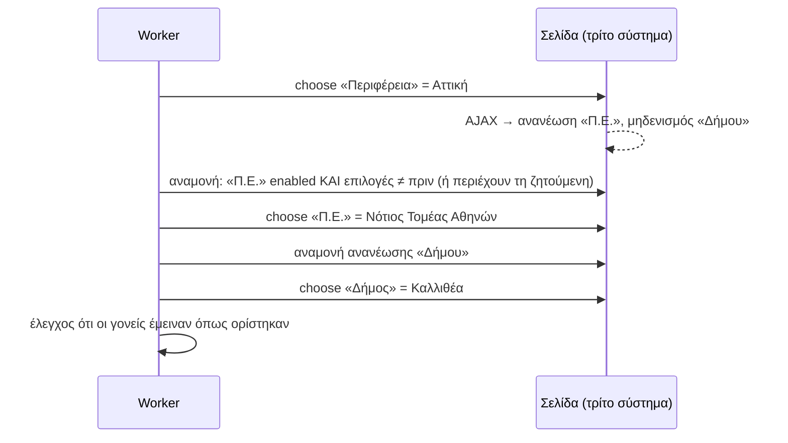

# 25 — Εξαρτώμενα πεδία (cascading combo boxes)

**Πρόβλημα:** πολλές φόρμες έχουν λίστες που εξαρτώνται η μία από την άλλη: Περιφέρεια → Περιφερειακή ενότητα → Δήμος, Κατηγορία δαπάνης → Υποκατηγορία, Δράση → Πρόσκληση → Μέτρο (ΟΠΣΚΕ), ΔΟΥ → Τμήμα (TAXIS). Η επιλογή στην πρώτη **ξαναφορτώνει** (συχνά με AJAX) τις τιμές της δεύτερης, μπορεί να **μηδενίσει** όσα είχαν ήδη επιλεγεί, ή να **εμφανίσει/κρύψει** άλλα πεδία. Μια αφελής εκτέλεση αποτυγχάνει γιατί επιλέγει πριν φορτώσουν οι τιμές, ή επιλέγει με λάθος σειρά, ή ψάχνει τιμή με ελαφρώς διαφορετικό κείμενο («Αττική» / «ΑΤΤΙΚΗΣ»).

---

## 1. Τι καταγράφει ο recorder

Για κάθε επιλογή σε λίστα (native `<select>`, ARIA `combobox`/`listbox`, autocomplete input, βιβλιοθήκες όπως select2, PrimeFaces, Angular Material, Kendo):

| Πεδίο | Περιεχόμενο |
|---|---|
| `widget` | `native` · `combobox` (ARIA) · `autocomplete` (πληκτρολόγηση + λίστα προτάσεων) · `custom` (με `optionLocator`) |
| `chosen` | label **και** value της επιλογής (όταν υπάρχει value) |
| `optionsSnapshot` | οι διαθέσιμες επιλογές τη στιγμή της επιλογής (έως 500: label, value) |
| `typedText` | για autocomplete: τι πληκτρολογήθηκε πριν εμφανιστεί η πρόταση |
| `effects` | τι άλλαξε στη σελίδα μέσα σε 3s μετά την επιλογή, μέσω MutationObserver και παρακολούθησης XHR/fetch: **ποιες άλλες λίστες άλλαξαν επιλογές**, ποιες μηδενίστηκαν, ποια πεδία εμφανίστηκαν ή κρύφτηκαν, ποιο request έγινε (URL pattern) |

Από τα `effects` προκύπτει αυτόματα το **γράφημα εξαρτήσεων**: `Περιφέρεια → Π.Ε. → Δήμος`.

### 1.1 Τι βλέπει ο χρήστης τη στιγμή που καταγράφει το βήμα

Η καταγραφή γίνεται από τον ίδιο τον χρήστη, που κάνει κανονικά τις επιλογές του. Ο recorder **δεν** τον καθυστερεί. Παρακολουθεί όμως τι προκαλεί κάθε επιλογή και το δείχνει αμέσως στο side panel:

```
┌ Βήματα ───────────────────────────────────────────────┐
│ 04  Περιφέρεια      = Αττική                ▾ λίστα   │
│     ↳ άλλαξε τις επιλογές του «Περιφ. ενότητα» (74→8) │
│     ↳ μηδένισε το «Δήμος»                             │
│ 05  Περιφ. ενότητα  = Νότιος Τομέας Αθηνών  ⛓ από 04  │
│     ↳ άλλαξε τις επιλογές του «Δήμος» (0→5)           │
│ 06  Δήμος           = Καλλιθέα              ⛓ από 05  │
│                                                       │
│ ⛓ Αλυσίδα: Περιφέρεια → Περιφ. ενότητα → Δήμος   [✎]  │
└───────────────────────────────────────────────────────┘
```

- **Ετικέτα «⛓ από 04»** σε κάθε εξαρτώμενο βήμα, και σύνοψη της αλυσίδας στο κάτω μέρος. Με το ✎ ο χρήστης διορθώνει μια λανθασμένη ανίχνευση, π.χ. αφαιρεί μια εξάρτηση που προέκυψε από σύμπτωση.
- **Στο highlight overlay** της σελίδας, όταν ο χρήστης ανοίγει τη λίστα‑παιδί, εμφανίζεται για 2s chip «εξαρτάται από: Περιφ. ενότητα».
- **Μεταβλητή ή σταθερή τιμή:** δίπλα σε κάθε λίστα υπάρχει γρήγορη επιλογή «Τιμή από είσοδο (Δήμος → `input.municipality`)» ή «Πάντα αυτή η τιμή». Τα εξαρτώμενα πεδία προτείνονται ως είσοδοι μαζί με τους γονείς τους. Δεν γίνεται ένα παιδί είσοδος ενώ ο γονέας του μένει σταθερός, εκτός αν το επιβεβαιώσει ο χρήστης.
- **Label ή κωδικός:** όταν οι επιλογές έχουν διαφορετικό value από το label (π.χ. `9186` / «Καλλιθέα»), ο recorder ρωτά μία φορά ανά λίστα: «Η εφαρμογή σας θα στέλνει το όνομα ή τον κωδικό;». Η απάντηση γίνεται `by: label | value` και ο τύπος της εισόδου (string ή enum από το snapshot).
- **Autocomplete:** όταν ο χρήστης πληκτρολογεί και διαλέγει από προτάσεις, το βήμα καταγράφεται ως **ένα** `choose` (όχι ως σειρά από `fill`/`click`), με `searchText` το τμήμα που πληκτρολόγησε.
- **Αλλαγή γνώμης:** αν ο χρήστης γυρίσει και αλλάξει τον γονέα **αφού** έχει διαλέξει το παιδί, εμφανίζεται «Αλλάξατε Περιφέρεια — ξαναδιαλέξτε Περιφ. ενότητα και Δήμο». Τα παλιά βήματα σημειώνονται ως ακυρωμένα και κρατιέται μόνο η τελική, συνεπής αλυσίδα.
- **Αργή φόρτωση:** αν οι επιλογές του παιδιού άργησαν (π.χ. > 2s), το βήμα σημειώνεται «αργή φόρτωση» και το `waitForOptions.timeoutMs` προτείνεται αυτόματα μεγαλύτερο.
- **Πεδία που εμφανίστηκαν** λόγω της επιλογής (π.χ. «Αριθμός ΓΕΜΗ» μετά από «Νομική μορφή = ΑΕ») σημειώνονται «εμφανίστηκε από 03», και το βήμα τους παίρνει αυτόματα `when` και `waitFor: visible`.

Όλα αυτά φαίνονται και στο παράθυρο «Ολοκληρώθηκε» (docs/24 §4), και η αλυσίδα επιβεβαιώνεται στην επανάληψη μπροστά στον χρήστη.

## 2. Νέο βήμα DSL `choose`

Το `select` του docs/05 μένει για απλές native λίστες. Για λίστες με εξαρτήσεις και για custom widgets, το compile παράγει `choose`:

```jsonc
{ "id": "s05", "type": "choose", "label": "Δήμος",
  "locator": { "candidates": [ { "kind": "label", "value": "Δήμος" } ] },
  "widget": "combobox",                       // native | combobox | autocomplete | custom
  "value": "{{input.municipality}}",
  "by": "label",                              // label | value | index
  "match": "normalized",                      // exact | normalized | contains | startsWith
  "dependsOn": ["s04"],                       // βήματα‑γονείς (Περιφερειακή ενότητα)
  "waitForOptions": {                         // αναμονή ανανέωσης επιλογών μετά τον γονέα
    "mode": "changed-or-contains",            // changed | contains | changed-or-contains
    "timeoutMs": 15000,
    "request": "**/api/municipalities*"       // προαιρετικό: περίμενε και αυτό το response
  },
  "searchText": "{{input.municipality | first 4}}", // για autocomplete: τι πληκτρολογείται
  "optionLocator": null,                      // για custom: πώς βρίσκονται οι επιλογές της λίστας
  "onMissing": "fail"                         // fail | first | skip | humanTask
}
```

- **`match: normalized`** (default): σύγκριση χωρίς τόνους, πεζά, με συμπτυγμένα κενά και χωρίς κοινές καταλήξεις γενικής (`ΑΤΤΙΚΗΣ` ≈ `Αττική`). Αν ταιριάζουν **πολλές** επιλογές → σφάλμα αμφισημίας, όχι τυχαία επιλογή.
- **`by: value`**: όταν η εφαρμογή του πελάτη γνωρίζει τους κωδικούς του συστήματος (π.χ. κωδικός Δήμου). Είναι ο πιο σταθερός τρόπος. Το `ValueMap` (docs/20) μπορεί να μετατρέπει ονόματα σε κωδικούς.
- **`onMissing`**: default `fail` με κωδικό `E_OPTION_NOT_FOUND`. Το `humanTask` ανοίγει τη ζωντανή προβολή (docs/22) για να επιλέξει ο χειριστής.

## 3. Πώς εκτελεί ο worker



1. **Σειρά:** τα βήματα `choose` μιας φόρμας εκτελούνται σε **τοπολογική σειρά** του γραφήματος `dependsOn` (γονέας πριν το παιδί), ανεξάρτητα από τη σειρά που δόθηκαν τα πεδία στο input. Το `validateDefinition` απορρίπτει κύκλους.
2. **Αναμονή επιλογών:** πριν από κάθε παιδί κρατιέται snapshot των επιλογών του και, μετά την επιλογή του γονέα, ο worker περιμένει μέχρι:
   - το παιδί να γίνει enabled και visible;
   - οι επιλογές να **αλλάξουν** σε σχέση με το snapshot ή να **περιέχουν** τη ζητούμενη τιμή (`mode`);
   - (προαιρετικά) να ολοκληρωθεί το request που καταγράφηκε στα `effects`.

   Χωρίς σταθερά `sleep`.
3. **Επιλογή ανά widget:**
   - `native`: Playwright `selectOption` (με value ή label μετά την κανονικοποίηση);
   - `combobox`: άνοιγμα, αναζήτηση της επιλογής στο listbox (role `option`), κλικ;
   - `autocomplete`: πληκτρολόγηση του `searchText` χαρακτήρα‑χαρακτήρα, αναμονή προτάσεων, επιλογή της σωστής (όχι απλώς «πρώτη»);
   - `custom`: άνοιγμα και αναζήτηση με το `optionLocator`.
4. **Επαλήθευση:** μετά από κάθε επιλογή διαβάζεται η εμφανιζόμενη τιμή. Πριν το επόμενο βήμα ελέγχεται ότι **οι γονείς δεν άλλαξαν** (κάποιες σελίδες μηδενίζουν και τα προηγούμενα). Αν άλλαξαν, ξαναγίνεται η αλυσίδα μία φορά. Αν αλλάξουν ξανά → `E_DEPENDENT_RESET`.
5. **Πεδία που εμφανίζονται υπό συνθήκη** (π.χ. «Αριθμός ΓΕΜΗ» μόνο για ΑΕ): τα βήματά τους έχουν `waitFor: visible` και `when` (από το `effects` της καταγραφής). Αν το πεδίο δεν εμφανιστεί και η τιμή του είναι κενή, το βήμα παραλείπεται.
6. **Σφάλματα με χρήσιμη πληροφορία:** το `E_OPTION_NOT_FOUND` επιστρέφει τις διαθέσιμες επιλογές (έως 50) και την πιο κοντινή πρόταση: «Δεν βρέθηκε "Καλιθέα" στον Δήμο. Μήπως: "Καλλιθέα";». Εμφανίζονται στη σελίδα εκτέλεσης, στο API (`problem.details.options`) και στο Excel αποτελεσμάτων.

## 4. Κατάλογος επιλογών και έλεγχος πριν την ουρά

Για να μη φτάνει στον browser ένα λάθος «Δήμος» και να αποτυγχάνει στο τελευταίο βήμα:

- **`OptionCatalog`:** για κάθε εξαρτώμενο πεδίο αποθηκεύονται οι επιλογές **ανά τιμή γονέα** (π.χ. Δήμοι ανά Π.Ε.), όπως τις είδε ο worker σε επιτυχημένες εκτελέσεις και σε health runs (docs/23). Ανανεώνεται συνεχώς και έχει ημερομηνία.
- **Προ‑έλεγχος:** με `Method.optionValidation = warn | strict | off` (default `warn`):
  - `warn`: η κλήση γίνεται δεκτή, αλλά επιστρέφεται προειδοποίηση με πρόταση διόρθωσης;
  - `strict`: `422 E_OPTION_INVALID` πριν την ουρά, χωρίς χρέωση και χωρίς άνοιγμα browser.

  Αν ο κατάλογος είναι παλιότερος από 7 ημέρες ή δεν περιέχει τον γονέα, ο έλεγχος παραλείπεται (δεν απορρίπτουμε σωστές τιμές λόγω παλιού καταλόγου).
- **Endpoint επιλογών** για την εφαρμογή του πελάτη, ώστε να χτίζει τα δικά της dropdowns με τις ίδιες τιμές:
  ```http
  GET /api/v1/opske/aitima-katavolis/options/municipality?region=Αττική&unit=Νότιος Τομέας Αθηνών
  → 200 { "options": [ { "label": "Καλλιθέα", "value": "9186" }, … ], "source": "catalog", "asOf": "2026-10-25T06:00:00Z" }
  ```
  Αν δεν υπάρχει στον κατάλογο, προαιρετικά `?live=true` κάνει σύντομο **READ run** που ανοίγει τη φόρμα μέχρι το πεδίο και διαβάζει τις επιλογές. Χρεώνεται ως εκτέλεση.
- **Excel (docs/20):** ο οδηγός αντιστοίχισης ελέγχει τις στήλες των εξαρτώμενων πεδίων με τον κατάλογο και δείχνει στην προεπισκόπηση «Γραμμή 14: ο Δήμος "Καλιθέα" δεν ανήκει στη Π.Ε. Νοτίου Τομέα — μήπως "Καλλιθέα";».

## 5. Καμβάς και επανάληψη

- Στον **καμβά** (docs/19), ο κόμβος «Φόρμα» δείχνει την αλυσίδα εξαρτήσεων ως μικρό διάγραμμα μέσα στον κόμβο (`Περιφέρεια → Π.Ε. → Δήμος`). Στον inspector ορίζονται `dependsOn`, `match`, `onMissing` και φαίνεται το τελευταίο snapshot επιλογών.
- Στην **επανάληψη μπροστά στον χρήστη** (docs/24 §6), η αναμονή φαίνεται ρητά: «Περιμένω να φορτώσουν οι Δήμοι…». Αν μια επιλογή δεν βρεθεί, εμφανίζεται λίστα με τις διαθέσιμες επιλογές για να διαλέξει ο χρήστης πώς θα γίνεται η αντιστοίχιση (label/value, κανονικοποίηση).
- Ο **recorder** προειδοποιεί αν ο χρήστης άλλαξε γονέα **μετά** το παιδί κατά την καταγραφή (π.χ. γύρισε πίσω και άλλαξε Περιφέρεια). Κρατιέται μόνο η τελική, συνεπής αλυσίδα.

## 6. Σφάλματα και incidents

| Κωδικός | Σημασία | Χρέωση | Incident (docs/23) |
|---|---|---|---|
| `E_OPTION_NOT_FOUND` | Η τιμή δεν υπάρχει στις επιλογές | Όχι (αποτυχία) | **Όχι** — θεωρείται σφάλμα δεδομένων |
| `E_OPTION_AMBIGUOUS` | Ταιριάζουν πολλές επιλογές | Όχι | Όχι |
| `E_OPTION_INVALID` | Απόρριψη πριν την ουρά (`strict`) | Όχι | Όχι |
| `E_OPTIONS_TIMEOUT` | Οι επιλογές του παιδιού δεν ανανεώθηκαν εγκαίρως | Όχι | Ναι, αν επαναλαμβάνεται στο ίδιο βήμα |
| `E_OPTIONS_EMPTY` | Η λίστα ήρθε κενή για γονέα που πριν είχε επιλογές | Όχι | **Ναι** — πιθανή αλλαγή συστήματος |
| `E_DEPENDENT_RESET` | Οι γονείς μηδενίζονται συνεχώς | Όχι | Ναι, αν επαναλαμβάνεται |

## 7. Δεδομένα

```prisma
model OptionCatalog {
  id          String   @id @default(cuid())
  tenantId    String
  versionId   String          // έκδοση ροής
  stepId      String          // το βήμα choose
  parentKey   String          // κανονικοποιημένες τιμές γονέων, π.χ. "attiki|notios-tomeas" ή "" για ρίζα
  options     Json            // [{ label, value }]
  seenAt      DateTime        // τελευταία φορά που τις είδε ο worker
  source      String          // RUN | HEALTH | LIVE
  @@unique([versionId, stepId, parentKey])
  @@index([tenantId])
}
```

Το `Method` αποκτά `optionValidation` (`warn` | `strict` | `off`).
