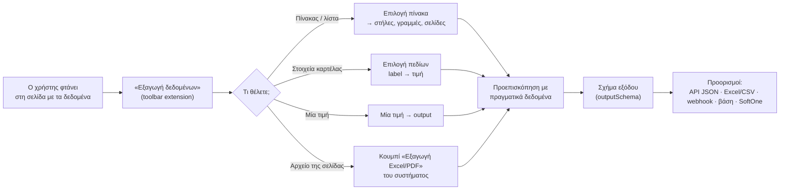

# 26 — Εξαγωγή δεδομένων: επιλογή πινάκων, στηλών και γραμμών και προορισμοί

**Ερώτημα:** σε μια κίνηση προβολής (READ, docs/24) ο χρήστης φτάνει στη σελίδα με αυτό που θέλει: έναν πίνακα αιτήσεων, μια λίστα παραστατικών, μια καρτέλα με στοιχεία. Πώς επιλέγει **ποια δεδομένα** κρατάμε (ποιον πίνακα, ποιες στήλες, ποιες γραμμές) και **πού πάνε**: Excel, JSON, ή η δική του βάση;

**Απάντηση:** με τη λειτουργία **«Εξαγωγή δεδομένων»** μέσα στην καταγραφή. Ο χρήστης δείχνει με το ποντίκι τι θέλει και το DG Complete φτιάχνει ένα **σχήμα εξαγωγής**: στήλες με ονόματα και τύπους, κλειδί, φίλτρα γραμμών, σελιδοποίηση. Σε κάθε εκτέλεση της μεθόδου, το σχήμα αυτό παράγει πάντα την ίδια δομή δεδομένων.

---

## 1. Ροή μέσα στην καταγραφή



Η «Εξαγωγή δεδομένων» μπορεί να γίνει και σε κινήσεις CREATE/UPDATE, για να διαβαστούν αποτελέσματα μετά την υποβολή. Συνήθως όμως είναι το κεντρικό κομμάτι μιας κίνησης READ.

## 2. Επιλογή πίνακα

1. Ο χρήστης πατά **«Εξαγωγή δεδομένων → Πίνακας»** και περνά το ποντίκι πάνω από τη σελίδα. Ο recorder φωτίζει **ολόκληρες δομές**, όχι μεμονωμένα κελιά: `<table>`, ARIA `grid`/`table`, ή **επαναλαμβανόμενες γραμμές** από divs (κάρτες, λίστες), που ανιχνεύονται από τη δομική ομοιότητα των αδερφών στοιχείων. Με ένα κλικ επιλέγεται ο πίνακας.
2. Ανοίγει ο **επιλογέας στηλών** στο side panel, με τις 5 πρώτες γραμμές ως δείγμα:

```
┌ Εξαγωγή δεδομένων · Πίνακας «Αιτήματα καταβολής» (23 γραμμές, σελίδα 1/4) ┐
│ ☑ Αρ. αιτήματος   → requestNo     κείμενο     🔑 κλειδί                   │
│ ☑ Ημ/νία υποβολής → submittedAt   ημερομηνία  dd/MM/yyyy                  │
│ ☑ Ποσό            → amount        ποσό €      1.240,00 → 1240.00          │
│ ☑ Κατάσταση       → status        κείμενο                                 │
│ ☐ Ενέργειες       (κουμπιά — παράλειψη)                                   │
│ ＋ Σύνδεσμος «Προβολή» → detailUrl (href)                                 │
├───────────────────────────────────────────────────────────────────────────┤
│ Γραμμές:  (•) Όλες   ( ) Μόνο όπου [Κατάσταση] [=] [Εγκρίθηκε]            │
│           ( ) Οι πρώτες [ 10 ]   ( ) Μόνο όσες διάλεξα (3) → κανόνας;     │
│ Σελίδες:  ☑ Όλες οι σελίδες  (βρέθηκε «Επόμενη ›»)  όριο [ 50 ] σελίδες   │
│ Ανά γραμμή: ☐ Άνοιγμα λεπτομερειών και εξαγωγή πεδίων …                  │
├───────────────────────────────────────────────────────────────────────────┤
│ Προεπισκόπηση JSON ▾   [Excel]                  [Ακύρωση]  [Προσθήκη ✓]   │
└───────────────────────────────────────────────────────────────────────────┘
```

### Στήλες
- **Επιλογή:** checkbox ανά στήλη. Οι στήλες χωρίς δεδομένα (κουμπιά, εικονίδια) αποεπιλέγονται αυτόματα.
- **Όνομα πεδίου:** από την επικεφαλίδα, με μεταγραφή ELOT 743 σε camelCase (`Αρ. αιτήματος` → `requestNo` μέσω λεξικού συνηθισμένων όρων, αλλιώς `ar_aitimatos`). Ο χρήστης μπορεί να το αλλάξει.
- **Τύπος και μετατροπή:** αυτόματη πρόταση από τις τιμές του δείγματος: κείμενο, αριθμός, **ποσό** (`1.240,00 €` → `1240.00`), **ημερομηνία** (`25/10/2026` → `2026-10-25`), ναι/όχι, ΑΦΜ, IBAN. Χρησιμοποιούνται οι μετασχηματισμοί του docs/20 §3.
- **Πρόσθετα από το κελί:** σύνδεσμος (`href`), `title`/tooltip, εικονίδιο κατάστασης → κείμενο (από `alt`/`aria-label`).
- **Κλειδί** 🔑: η στήλη (ή οι στήλες) που ταυτοποιεί μοναδικά τη γραμμή. Χρειάζεται για upsert στη βάση και για «μόνο νέες/αλλαγμένες» (§5).
- **Στήλες χωρίς επικεφαλίδα** ή με συγχωνευμένες επικεφαλίδες: ονομάζονται από τον χρήστη. Η θέση τους κρατιέται **και** με βάση το κείμενο της επικεφαλίδας, ώστε να μην μπερδευτούν αν αλλάξει η σειρά των στηλών.

### Γραμμές
- **Όλες**, **φίλτρο** με συνθήκη σε στήλη (`=`, `≠`, περιέχει, `>`/`<` για αριθμούς και ημερομηνίες), **οι πρώτες N**, ή **«Μόνο όσες διάλεξα»**: ο χρήστης κάνει κλικ σε συγκεκριμένες γραμμές και ο recorder προτείνει τον κανόνα που τις περιγράφει (π.χ. «όπου Κατάσταση = Εγκρίθηκε»), επειδή οι ίδιες γραμμές δεν θα υπάρχουν στην επόμενη εκτέλεση.
- Οι γραμμές συνόλων και οι κενές γραμμές εντοπίζονται και αποκλείονται αυτόματα, με δυνατότητα αναίρεσης.
- Τα φίλτρα μπορούν να δέχονται **είσοδο**: `Κατάσταση = {{input.status}}`, `Ημ/νία ≥ {{input.from}}`. Έτσι γίνονται query params του `GET` (docs/24 §5).

### Σελιδοποίηση
- Ανιχνεύονται αυτόματα το «Επόμενη ›», οι αριθμοί σελίδων, το «Φόρτωση περισσότερων» και το infinite scroll. Ο χρήστης επιβεβαιώνει με ένα κλικ στο στοιχείο.
- Εκτέλεση: εξαγωγή σελίδας → κλικ «Επόμενη» → αναμονή αλλαγής των γραμμών (όχι σταθερό sleep) → επανάληψη μέχρι να μην υπάρχει επόμενη ή να φτάσει το όριο σελίδων. Αν η ίδια σελίδα επαναληφθεί, ο βρόχος σταματά με προειδοποίηση.
- Αν το σύστημα έχει επιλογή «εμφάνιση 100 ανά σελίδα», προτείνεται ως πρώτο βήμα για λιγότερες σελίδες.

### Λεπτομέρειες ανά γραμμή
Όταν ο πίνακας δείχνει μόνο σύνοψη, ο χρήστης ενεργοποιεί **«Ανά γραμμή: άνοιγμα λεπτομερειών»**, κάνει μία φορά κλικ στο «Προβολή» της πρώτης γραμμής και επιλέγει πεδία στην καρτέλα (§3). Η ροή γίνεται `forEach` γραμμή: άνοιγμα → εξαγωγή → επιστροφή. Τα πεδία της καρτέλας προστίθενται στη γραμμή. Υπάρχει όριο γραμμών, γιατί κάθε άνοιγμα παίρνει χρόνο.

## 3. Επιλογή στοιχείων καρτέλας (label → τιμή)

Για σελίδες τύπου «καρτέλα» (στοιχεία δικαιούχου, λεπτομέρειες αίτησης), ο χρήστης κάνει κλικ σε κάθε τιμή που θέλει. Ο recorder:
- βρίσκει αυτόματα το **label** της τιμής (από `<label>`, `<dt>`/`<dd>`, το αριστερό κελί σε πίνακα δύο στηλών, ή το πλησιέστερο κείμενο) και προτείνει όνομα πεδίου;
- κάνει τον locator της τιμής **σχετικό με το label** («η τιμή δίπλα στο "ΑΦΜ"»), ώστε να αντέχει αλλαγές στη διάταξη;
- με το **«Όλα τα πεδία της ενότητας»** επιλέγει με ένα κλικ όλα τα ζεύγη label/τιμή ενός πλαισίου, και ο χρήστης αποεπιλέγει όσα δεν θέλει.

## 4. Αρχεία που δίνει το ίδιο το σύστημα

Πολλά συστήματα (και το TAXIS/ΟΠΣΚΕ) έχουν κουμπί «Εξαγωγή σε Excel» ή «Εκτύπωση PDF». Αν ο χρήστης το πατήσει στην καταγραφή, ο recorder προτείνει:
- **Κράτημα του αρχείου όπως είναι** (π.χ. βεβαίωση PDF) ως `FileObject` (docs/21), διαθέσιμο από το API;
- **ή ανάγνωση του αρχείου** (XLSX/CSV) με τον ίδιο επιλογέα στηλών του §2, πάνω στο αρχείο αντί για τη σελίδα. Είναι συνήθως πιο αξιόπιστο από την ανάγνωση της οθόνης και δεν χρειάζεται σελιδοποίηση.

## 5. Βήμα DSL `extractTable`

```jsonc
{ "id": "s07", "type": "extractTable", "label": "Αιτήματα καταβολής",
  "source": { "kind": "dom", "locator": { "candidates": [ { "kind": "role", "role": "table", "name": "Αιτήματα" } ] } },
  // ή { "kind": "download", "trigger": { …locator κουμπιού… }, "format": "xlsx", "sheet": 0 }
  "rows": { "locator": "tbody tr", "skip": ["total", "empty"] },
  "columns": [
    { "key": "requestNo",   "header": "Αρ. αιτήματος",   "type": "string", "key": true },
    { "key": "submittedAt", "header": "Ημ/νία υποβολής", "type": "date", "format": "dd/MM/yyyy" },
    { "key": "amount",      "header": "Ποσό",            "type": "money" },
    { "key": "status",      "header": "Κατάσταση",       "type": "string" },
    { "key": "detailUrl",   "header": "Ενέργειες",       "from": "href", "cell": "a:has-text('Προβολή')" }
  ],
  "filter": { "all": [ { "column": "status", "op": "eq", "value": "{{input.status}}" } ] },
  "limit": null,
  "pagination": { "next": { "candidates": [ { "kind": "role", "role": "link", "name": "Επόμενη" } ] }, "maxPages": 50 },
  "perRow": null,                        // ή { "open": {…}, "steps": [ …extract… ], "back": true, "maxRows": 200 }
  "into": "output.items" }
```

- Το `outputSchema` παράγεται αυτόματα: `items: array<{ requestNo: string, submittedAt: date, amount: number, … }>`. Εμφανίζεται στο OpenAPI/Postman και στην τεκμηρίωση (docs/17).
- **Επαλήθευση σε κάθε εκτέλεση:** αν λείπει μια επικεφαλίδα που έχει επιλεγεί → `E_COLUMN_MISSING` (μετρά για incident, docs/23, γιατί σημαίνει αλλαγή της οθόνης). Αν μια τιμή δεν μετατρέπεται στον τύπο της (π.χ. ποσό) → η γραμμή περιλαμβάνεται με `_errors` και προειδοποίηση, όχι αποτυχία όλου του run.
- **Μεγάλα αποτελέσματα:** έως 5 MB επιστρέφονται inline στο `output`. Πάνω από αυτό, τα δεδομένα γράφονται σε αρχείο (JSON Lines/XLSX, docs/21) και το `output` περιέχει `{ count, fileId, preview: [πρώτες 20] }`.

## 6. Πού πάνε τα δεδομένα (προορισμοί)

Ανά μέθοδο ορίζονται ένας ή περισσότεροι **προορισμοί** (`Destination`). Τρέχουν μετά από κάθε επιτυχημένη εκτέλεση και ο καθένας έχει δικό του log και retries, ώστε η αποτυχία ενός προορισμού να μην κάνει αποτυχημένη την εκτέλεση.

| Προορισμός | Τι κάνει | Φάση |
|---|---|---|
| **API (JSON)** | Το `output` στην απάντηση του `GET` ή στο `GET /runs/{id}`. Είναι πάντα διαθέσιμο. | MVP |
| **Αρχείο Excel / CSV / JSON** | Δημιουργία αρχείου ανά εκτέλεση, με λήψη από τη σελίδα της εκτέλεσης και από το API (`/runs/{id}/output.xlsx`, `.csv`, `.json`). Προαιρετικά συσσωρευτικό αρχείο ανά μήνα. | MVP |
| **Webhook** | `POST` στο endpoint του πελάτη με τις γραμμές σε batches (π.χ. 500), υπογεγραμμένο HMAC όπως τα webhooks του docs/07. Είναι ο συνιστώμενος τρόπος για «τη δική μου βάση»: η εφαρμογή του πελάτη κάνει το upsert. | MVP |
| **Βάση δεδομένων πελάτη** | Απευθείας **upsert** σε πίνακα PostgreSQL / MySQL / SQL Server του πελάτη με βάση το κλειδί, αντιστοίχιση πεδίων → στηλών και τύπων, και προαιρετική δημιουργία πίνακα. Η σύνδεση γίνεται με χρήστη που έχει δικαίωμα μόνο σε αυτόν τον πίνακα, και η IP των workers μπαίνει στο allowlist του πελάτη. | Φάση 2 |
| **SoftOne** | Εγγραφή στο SoftOne του πελάτη μέσω web services (`setData`), αφού οι πελάτες της DGsoft έχουν SoftOne, με αντιστοίχιση πεδίων σε αντικείμενο/πίνακα. | Φάση 2 |
| **Φάκελος (Synology / SFTP / WebDAV)** | Αποθήκευση του αρχείου σε κοινόχρηστο φάκελο του πελάτη. | Φάση 3 |

### Μόνο νέα ή αλλαγμένα (incremental)
Με ορισμένο **κλειδί**, ο προορισμός μπορεί να στέλνει:
- **όλα** σε κάθε εκτέλεση;
- **μόνο νέα** (κλειδιά που δεν έχουν σταλεί);
- **νέα και αλλαγμένα**, με σύγκριση hash των υπόλοιπων στηλών. Τα αλλαγμένα σημειώνονται με `_change: "new" | "updated"`, και προαιρετικά στέλνονται και όσα **χάθηκαν** (`"removed"`).

Η κατάσταση κρατιέται στο `ExtractSnapshot` (κλειδί → hash) ανά μέθοδο, προορισμό και credential, π.χ. ανά δικαιούχο της WWA. Σε συνδυασμό με τις προγραμματισμένες εκτελέσεις (φάση 3, `Schedule`), αυτό δίνει **τακτικό συγχρονισμό**, π.χ. «κάθε πρωί, όλες οι νέες εγκρίσεις του ΟΠΣΚΕ για κάθε δικαιούχο, στη βάση μας».

### Αντιστοίχιση στη βάση του πελάτη
- Ίδιος επιλογέας με τον οδηγό Excel (docs/20), αντίστροφα: **πεδίο εξόδου → στήλη πίνακα**, με μετασχηματισμούς και σταθερές (π.χ. `source = 'OPSKE'`, `afm = credentialRef`).
- **Πρόσθετες στήλες** που προστίθενται αυτόματα, αν ζητηθούν: `_run_id`, `_extracted_at`, `_credential_ref` (δικαιούχος), `_change`.
- **Δοκιμή σύνδεσης** και **«Δοκιμαστική εγγραφή 1 γραμμής»** πριν την ενεργοποίηση.

## 7. Προεπισκόπηση και επανάληψη

- Η προεπισκόπηση στο side panel δείχνει **τα πραγματικά δεδομένα** της σελίδας, μετά τις μετατροπές, ως πίνακα ή JSON, και μπορεί να κατέβει ως Excel. Ο χρήστης βλέπει αμέσως αν το ποσό ή η ημερομηνία διαβάστηκαν σωστά.
- Στην **επανάληψη μπροστά στον χρήστη** (docs/24 §6), οι στήλες που διαβάζονται φωτίζονται στη σελίδα και ο πίνακας γεμίζει ζωντανά, σελίδα‑σελίδα. Στο τέλος εμφανίζεται «23 γραμμές από 4 σελίδες, 0 προειδοποιήσεις».
- Στον **καμβά** (docs/19), ο κόμβος «Ανάγνωση πίνακα» δείχνει τις στήλες και, στις εκτελέσεις, πόσες γραμμές διαβάστηκαν ανά σελίδα.

## 8. Δεδομένα

```prisma
model Destination {
  id          String   @id @default(cuid())
  tenantId    String
  methodId    String
  kind        String   // FILE | WEBHOOK | DATABASE | SOFTONE | FOLDER
  name        String
  config      Json     // ανά kind: format, url, table, mapping, batchSize, mode (all|new|changed) …
  secretEnc   String?  // κρυπτογραφημένα στοιχεία σύνδεσης (lib/crypto, docs/02)
  isActive    Boolean  @default(true)
  lastRunAt   DateTime?
  lastStatus  String?
  createdAt   DateTime @default(now())
  updatedAt   DateTime @updatedAt
  @@index([tenantId, methodId])
}

model DestinationDelivery {   // ανά εκτέλεση × προορισμό
  id            String   @id @default(cuid())
  tenantId      String
  destinationId String
  runId         String
  status        String   // PENDING | SENT | FAILED | SKIPPED
  rows          Int      @default(0)
  newRows       Int      @default(0)
  changedRows   Int      @default(0)
  attempts      Int      @default(0)
  error         String?
  createdAt     DateTime @default(now())
  @@index([destinationId, createdAt])
}

model ExtractSnapshot {       // για «μόνο νέα / αλλαγμένα»
  id            String   @id @default(cuid())
  tenantId      String
  destinationId String
  scopeKey      String   // π.χ. credentialRef
  rowKey        String
  rowHash       String
  seenAt        DateTime
  @@unique([destinationId, scopeKey, rowKey])
}
```

Οι αποστολές σε προορισμούς γίνονται από την ουρά `destinations` του worker (docs/06), με retries και backoff, και φαίνονται στη σελίδα της εκτέλεσης: «Webhook: 23 γραμμές ✓ · Βάση: 3 νέες, 1 αλλαγμένη ✓».
